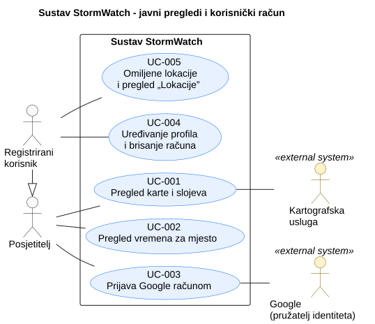
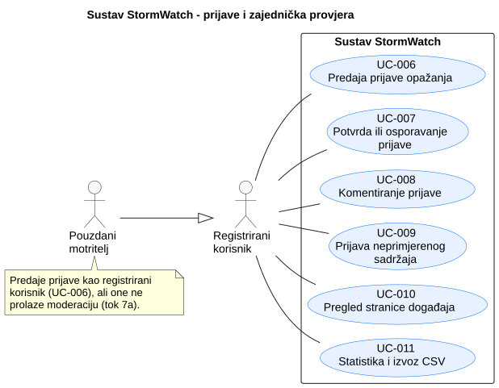
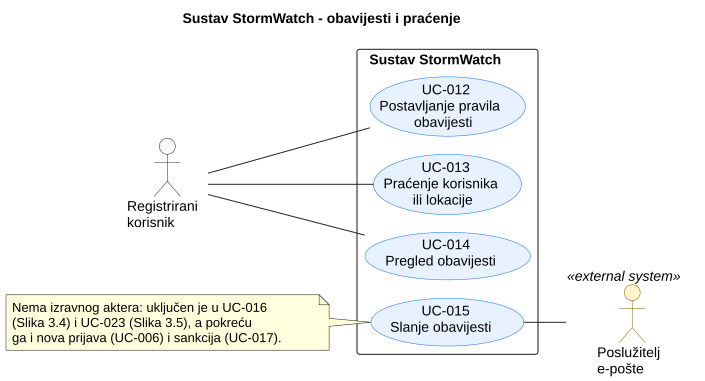
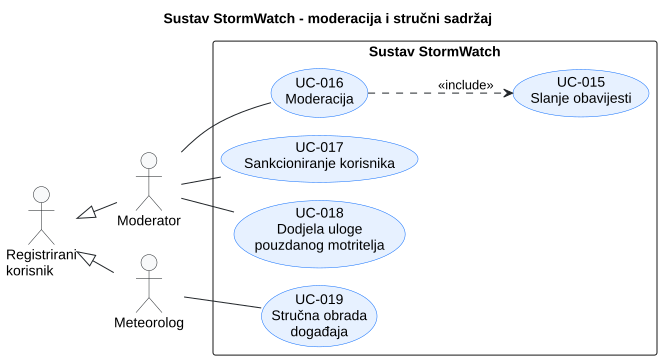
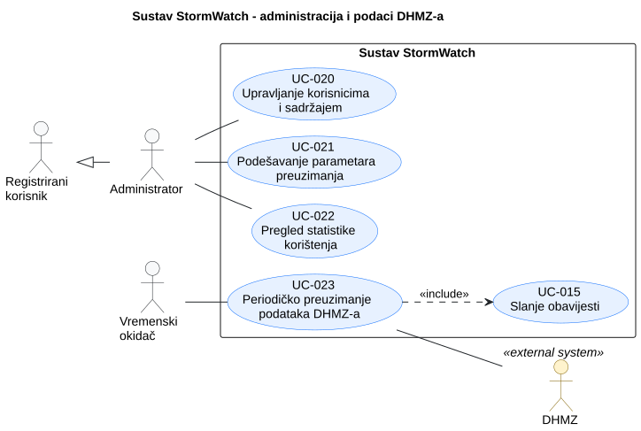

# 3. Obrasci uporabe

## 3.1 Dijagrami obrazaca uporabe

Obrasci uporabe prikazani su na pet manjih dijagrama, po istim područjima po kojima su grupirani funkcijski zahtjevi u [odjeljku 2.1](2-Analiza-zahtjeva.md#21-funkcijski-zahtjevi). Svaki dijagram prikazuje samo aktere važne za svoje područje. Registrirani korisnik nasljeđuje posjetitelja, a pouzdani motritelj, moderator, meteorolog i administrator nasljeđuju registriranog korisnika i mogu sve što i on.

| Slika | Područje                          | Obrasci uporabe | Akteri                                                          |
| ----- | --------------------------------- | --------------- | --------------------------------------------------------------- |
| 3.1   | Javni pregledi i korisnički račun | UC-001 – UC-005 | Posjetitelj, registrirani korisnik, kartografska usluga, Google |
| 3.2   | Prijave i zajednička provjera     | UC-006 – UC-011 | Registrirani korisnik, pouzdani motritelj                       |
| 3.3   | Obavijesti i praćenje             | UC-012 – UC-015 | Registrirani korisnik, poslužitelj e-pošte                      |
| 3.4   | Moderacija i stručni sadržaj      | UC-016 – UC-019 | Moderator, meteorolog                                           |
| 3.5   | Administracija i podaci DHMZ-a    | UC-020 – UC-023 | Administrator, vremenski okidač, DHMZ                           |

### 3.1.1 Javni pregledi i korisnički račun

**Slika 3.1. Javni pregledi i korisnički račun**

**PlantUML izvor:** [izvor](./puml/3-1-stormwatch-public-account-UC.puml)

### 3.1.2 Prijave i zajednička provjera

**Slika 3.2. Prijave i zajednička provjera**

**PlantUML izvor:** [izvor](./puml/3-2-stormwatch-reports-UC.puml)

### 3.1.3 Obavijesti i praćenje

**Slika 3.3. Obavijesti i praćenje**

**PlantUML izvor:** [izvor](./puml/3-3-stormwatch-notifications-UC.puml)

### 3.1.4 Moderacija i stručni sadržaj

**Slika 3.4. Moderacija i stručni sadržaj**

**PlantUML izvor:** [izvor](./puml/3-4-stormwatch-moderation-UC.puml)

### 3.1.5 Administracija i podaci DHMZ-a

**Slika 3.5. Administracija i podaci DHMZ-a**

**PlantUML izvor:** [izvor](./puml/3-5-stormwatch-admin-UC.puml)

## 3.2 Specifikacije obrazaca uporabe

Svi obrasci uporabe sažeti su u tablici ispod, a šest ključnih (UC-001, UC-003, UC-006, UC-007, UC-016 i UC-023) opisano je i detaljno. Obrasci registriranih korisnika pretpostavljaju da je korisnik prijavljen. Oznake PR-xx i P-xx su poslovna pravila i parametri iz [odjeljka 2.1](2-Analiza-zahtjeva.md#21-funkcijski-zahtjevi).

| ID     | Obrazac uporabe                                                                          | Primarni akter        | Zahtjevi                          | Sažetak                                                                                                                                                                                                  |
| ------ | ---------------------------------------------------------------------------------------- | --------------------- | --------------------------------- | -------------------------------------------------------------------------------------------------------------------------------------------------------------------------------------------------------- |
| UC-001 | [Pregled karte i slojeva](#uc-001-pregled-karte-i-slojeva)                               | Posjetitelj           | F-003, F-005, F-006, NF-02        | Pregledava kartu sa slojevima postaja, upozorenja i prijava te filtrira prijave.                                                                                                                         |
| UC-002 | Pregled vremena za mjesto                                                                | Posjetitelj           | F-005, F-007                      | Za odabrano mjesto vidi mjerenja najbliže postaje, prognozu i aktivna upozorenja; bez upozorenja piše „Nema aktivnih upozorenja”.                                                                        |
| UC-003 | [Prijava Google računom](#uc-003-prijava-google-računom)                                 | Posjetitelj           | F-001, F-002, F-003               | Prijavljuje se i odjavljuje Google računom; pri prvoj prijavi nastaje račun.                                                                                                                             |
| UC-004 | Uređivanje profila i brisanje računa                                                     | Registrirani korisnik | F-004                             | Mijenja fotografiju i opis profila ili briše račun, a njegove prijave tada ostaju uz autora „izbrisani korisnik”.                                                                                        |
| UC-005 | Omiljene lokacije i pregled „Lokacije”                                                   | Registrirani korisnik | F-008                             | Sprema do P-01 omiljenih lokacija i za svaku vidi uvjete, prognozu i upozorenja.                                                                                                                         |
| UC-006 | [Predaja prijave opažanja](#uc-006-predaja-prijave-opažanja)                             | Registrirani korisnik | F-009, F-010, F-011, F-016, F-022 | Predaje prijavu nevremena s lokacijom, fotografijama i mjerenjem najbliže postaje.                                                                                                                       |
| UC-007 | [Potvrda ili osporavanje prijave](#uc-007-potvrda-ili-osporavanje-prijave)               | Registrirani korisnik | F-012, F-013, F-021               | Glasa za tuđu prijavu, a sustav ponovno izračunava ocjenu vjerodostojnosti.                                                                                                                              |
| UC-008 | Komentiranje prijave                                                                     | Registrirani korisnik | F-014                             | Objavljuje komentar uz prijavu; ostali ga vide bez osvježavanja stranice.                                                                                                                                |
| UC-009 | Prijava neprimjerenog sadržaja                                                           | Registrirani korisnik | F-015                             | Prijavljuje prijavu ili komentar moderatorima uz razlog; isti sadržaj ne može prijaviti dvaput.                                                                                                          |
| UC-010 | Pregled stranice događaja                                                                | Registrirani korisnik | F-016                             | Otvara događaj sa stručnim komentarom na vrhu te prijavama, fotografijama i raspravom koje smije vidjeti (PR-07).                                                                                        |
| UC-011 | Statistika i izvoz CSV                                                                   | Registrirani korisnik | F-017                             | Filtrira arhivu događaja, pregledava grafikon učestalosti i izvozi iste podatke u CSV.                                                                                                                   |
| UC-012 | Postavljanje pravila obavijesti                                                          | Registrirani korisnik | F-008, F-018                      | Za omiljenu lokaciju postavlja pravilo za upozorenje DHMZ-a ili za potvrđenu prijavu unutar polumjera P-02.                                                                                              |
| UC-013 | Praćenje korisnika ili lokacije                                                          | Registrirani korisnik | F-019                             | Prati korisnika ili lokaciju i prima obavijesti o njihovim novim prijavama; praćenje može prekinuti.                                                                                                     |
| UC-014 | Pregled obavijesti                                                                       | Registrirani korisnik | F-020                             | Otvara pregled „Obavijesti”; otvorena obavijest postaje pročitana i vodi na prijavu, događaj ili upozorenje.                                                                                             |
| UC-015 | Slanje obavijesti                                                                        | Sustav                | F-018, F-019, F-020               | Uključen u UC-016 i UC-023, a pokreću ga i nova prijava i sankcija: korisnicima čija su pravila ili praćenja ispunjena sustav stvara obavijest i šalje je e-poštom.                                      |
| UC-016 | [Moderacija](#uc-016-moderacija)                                                         | Moderator             | F-011, F-021, F-023               | Potvrđuje, odbija ili briše prijave na čekanju i prijavljeni sadržaj iz svojih regija.                                                                                                                   |
| UC-017 | Sankcioniranje korisnika                                                                 | Moderator             | F-024                             | Korisniku upućuje upozorenje ili privremenu zabranu objavljivanja (P-09), koja istječe bez ručne radnje.                                                                                                 |
| UC-018 | Dodjela uloge pouzdanog motritelja                                                       | Moderator             | F-021, F-022                      | Korisniku s reputacijom ≥ P-08 dodjeljuje ulogu pouzdanog motritelja.                                                                                                                                    |
| UC-019 | Stručna obrada događaja                                                                  | Meteorolog            | F-025                             | Objavljuje stručni komentar uz događaj i označava prijave vrijedne za stručnu analizu.                                                                                                                   |
| UC-020 | Upravljanje korisnicima i sadržajem                                                      | Administrator         | F-027, F-030                      | Pretražuje korisnike, dodjeljuje uloge (moderatoru barem jednu regiju), deaktivira račune i briše sadržaj. Prvi administrator određuje se pri postavljanju sustava adresom e-pošte svojeg Google računa. |
| UC-021 | Podešavanje parametara preuzimanja                                                       | Administrator         | F-028                             | Mijenja interval i adrese izvora DHMZ-a; promjena vrijedi od sljedećeg ciklusa, a interval kraći od 10 min se odbija.                                                                                    |
| UC-022 | Pregled statistike korištenja                                                            | Administrator         | F-029                             | Za odabrano razdoblje vidi broj korisnika, broj prijava po stanju i ishode preuzimanja.                                                                                                                  |
| UC-023 | [Periodičko preuzimanje podataka DHMZ-a](#uc-023-periodičko-preuzimanje-podataka-dhmz-a) | Vremenski okidač      | F-018, F-026, NF-03               | Periodički preuzima i pohranjuje mjerenja, prognoze i upozorenja DHMZ-a.                                                                                                                                 |

### UC-001: Pregled karte i slojeva

| Element specifikacije             | Opis                                                                                                                                                                                                                                                                                                                                                                                               |
| :-------------------------------- | :------------------------------------------------------------------------------------------------------------------------------------------------------------------------------------------------------------------------------------------------------------------------------------------------------------------------------------------------------------------------------------------------- |
| **Primarni akter**                | A-01 Posjetitelj (i svi akteri koji ga nasljeđuju); sekundarni: A-09 Kartografska usluga                                                                                                                                                                                                                                                                                                           |
| **Povezani zahtjevi**             | F-003, F-005, F-006, NF-02                                                                                                                                                                                                                                                                                                                                                                         |
| **Preduvjeti**                    | Pohranjeni su podaci DHMZ-a.                                                                                                                                                                                                                                                                                                                                                                       |
| **Glavni uspješni tok**           | 1. Korisnik otvara naslovnicu. 2. Sustav prikazuje kartu Hrvatske sa slojevima mjernih postaja i upozorenja te vrijeme posljednjeg preuzimanja. 3. Korisnik pomiče i zumira kartu te uključuje sloj prijava. 4. Sustav prikazuje prijave koje korisnik smije vidjeti (PR-07). 5. Korisnik odabire mjernu postaju; sustav prikazuje njezina posljednja mjerenja uz navod „Izvor: DHMZ”. |
| **Alternativni tokovi / Iznimke** | **2a) Kartografska usluga nije dostupna:** sustav prikazuje poruku i popis aktivnih upozorenja. **3a) Korisnik postavlja filtar:** sustav prikazuje samo prijave odabrane vrste pojave i razdoblja. **4a) Korisnik nije prijavljen:** prikazuju se samo potvrđene prijave.                                                                                                                   |
| **Posljedice (ishod)**            | Podaci se ne mijenjaju; nove prijave pojavljuju se bez osvježavanja stranice.                                                                                                                                                                                                                                                                                                                      |

### UC-003: Prijava Google računom

| Element specifikacije             | Opis                                                                                                                                                                                                                                                                                                                                                                                                                                                                       |
| :-------------------------------- | :------------------------------------------------------------------------------------------------------------------------------------------------------------------------------------------------------------------------------------------------------------------------------------------------------------------------------------------------------------------------------------------------------------------------------------------------------------------------- |
| **Primarni akter**                | A-01 Posjetitelj; sekundarni: A-11 Google                                                                                                                                                                                                                                                                                                                                                                                                                                  |
| **Povezani zahtjevi**             | F-001, F-002, F-003                                                                                                                                                                                                                                                                                                                                                                                                                                                        |
| **Preduvjeti**                    | Korisnik nije prijavljen i ima Google račun.                                                                                                                                                                                                                                                                                                                                                                                                                               |
| **Glavni uspješni tok**           | 1. Korisnik odabire „Prijava Google računom”. 2. Sustav ga preusmjerava na Googleovu stranicu za prijavu, gdje se korisnik prijavljuje. 3. Google vraća korisnika u sustav s potvrdom identiteta (ID token). 4. Sustav provjerava potvrdu identiteta (NF-04) i pronalazi račun povezan s tim Google računom. 5. Sustav izdaje pristupni token; korisniku su dostupne funkcije za registrirane korisnike. 6. Korisnik se odjavljuje; sustav poništava token. |
| **Alternativni tokovi / Iznimke** | **2a) Korisnik odustane na Googleovoj stranici:** ostaje neprijavljen. **4a) Prva prijava (registracija):** sustav prikazuje predloženo korisničko ime i obavijest o privatnosti; kad korisnik odabere jedinstveno korisničko ime i potvrdi obavijest, sustav stvara račun s adresom e-pošte iz Google računa i nastavlja u koraku 5. **4b) Potvrda identiteta nije valjana ili je račun deaktiviran:** sustav odbija prijavu uz poruku.                             |
| **Posljedice (ishod)**            | Korisnik je prijavljen (ima valjan token) ili odjavljen; pri prvoj prijavi nastaje račun. Odjava iz StormWatcha ne odjavljuje korisnika iz Google računa.                                                                                                                                                                                                                                                                                                                  |

### UC-006: Predaja prijave opažanja

| Element specifikacije             | Opis                                                                                                                                                                                                                                                                                                                                                                                                                                                                                                                                                                                                                                                                                                 |
| :-------------------------------- | :--------------------------------------------------------------------------------------------------------------------------------------------------------------------------------------------------------------------------------------------------------------------------------------------------------------------------------------------------------------------------------------------------------------------------------------------------------------------------------------------------------------------------------------------------------------------------------------------------------------------------------------------------------------------------------------------------- |
| **Primarni akter**                | A-02 Registrirani korisnik (inačica: A-03 Pouzdani motritelj)                                                                                                                                                                                                                                                                                                                                                                                                                                                                                                                                                                                                                                        |
| **Povezani zahtjevi**             | F-009, F-010, F-011, F-016, F-022                                                                                                                                                                                                                                                                                                                                                                                                                                                                                                                                                                                                                                                                    |
| **Preduvjeti**                    | Korisnik nema zabranu objavljivanja (PR-09).                                                                                                                                                                                                                                                                                                                                                                                                                                                                                                                                                                                                                                                         |
| **Glavni uspješni tok**           | 1. Korisnik odabire „Nova prijava”. 2. Sustav prikazuje obrazac s unaprijed popunjenim vremenom opažanja i lokacijom dobivenom putem GPS-a. 3. Korisnik odabire vrstu pojave, intenzitet (za tuču veličinu zrna) i procjenu štete, dodaje fotografije i po želji opis. 4. Korisnik potvrđuje predaju. 5. Sustav provjerava podatke (PR-01) i fotografije (NF-06), pohranjuje prijavu u stanju „predana” i prikazuje potvrdu zaprimanja. 6. Sustav uklanja EXIF metapodatke, pridružuje mjerenje najbliže postaje (PR-08) i pridružuje prijavu događaju (PR-04). 7. Sustav postavlja stanje „na čekanju” i prikazuje prijavu ostalim registriranim korisnicima i moderatoru regije. |
| **Alternativni tokovi / Iznimke** | **2a) GPS nije dostupan ili pristup lokaciji nije dopušten:** korisnik odabire lokaciju na karti. **5a) Nedostaje obavezan podatak ili fotografija nije ispravna:** sustav označava polja i zadržava unos; prijava se ne pohranjuje. **6a) Nema mjerenja postaje unutar P-04:** uz prijavu piše „Nema službenog mjerenja za vrijeme opažanja”. **7a) Autor je pouzdani motritelj:** prijava odmah prelazi u stanje „potvrđena” s posebnom oznakom i ne ulazi u red moderacije.                                                                                                                                                                                                              |
| **Posljedice (ishod)**            | Prijava je pohranjena u stanju „na čekanju” ili „potvrđena”; autor je vidi na pregledu „Prijave”, a pratitelji autora i lokacije dobivaju obavijest (UC-015).                                                                                                                                                                                                                                                                                                                                                                                                                                                                                                                                        |

### UC-007: Potvrda ili osporavanje prijave

| Element specifikacije             | Opis                                                                                                                                                                                                                                                                                                                                                                                                                                                                                    |
| :-------------------------------- | :-------------------------------------------------------------------------------------------------------------------------------------------------------------------------------------------------------------------------------------------------------------------------------------------------------------------------------------------------------------------------------------------------------------------------------------------------------------------------------------- |
| **Primarni akter**                | A-02 Registrirani korisnik                                                                                                                                                                                                                                                                                                                                                                                                                                                              |
| **Povezani zahtjevi**             | F-012, F-013, F-021                                                                                                                                                                                                                                                                                                                                                                                                                                                                     |
| **Preduvjeti**                    | Prijava je u stanju „na čekanju” ili „potvrđena”, a korisnik nije njezin autor.                                                                                                                                                                                                                                                                                                                                                                                                         |
| **Glavni uspješni tok**           | 1. Korisnik otvara prijavu na karti, na stranici događaja ili iz obavijesti. 2. Sustav prikazuje prijavu s fotografijama, mjerenjem najbliže postaje, brojem potvrda i osporavanja te ocjenom vjerodostojnosti. 3. Korisnik odabire „I ja to vidim” ili „Kod mene nije tako”. 4. Sustav bilježi glas, ponovno izračunava ocjenu vjerodostojnosti (PR-03) i ažurira reputaciju autora (PR-05). 5. Sustav prikazuje novu ocjenu svim korisnicima koji imaju prijavu otvorenu. |
| **Alternativni tokovi / Iznimke** | **3a) Korisnik je već glasao:** odabir drugog gumba mijenja glas, a ponovni odabir istog gumba povlači glas (PR-02). **3b) Korisnik nije prijavljen:** sustav ga preusmjerava na prijavu u sustav (UC-003).                                                                                                                                                                                                                                                                          |
| **Posljedice (ishod)**            | Glas je zabilježen, a ocjena vjerodostojnosti i reputacija autora su ažurirane.                                                                                                                                                                                                                                                                                                                                                                                                         |

### UC-016: Moderacija

| Element specifikacije             | Opis                                                                                                                                                                                                                                                                                                                                                                                                                                                                                                                    |
| :-------------------------------- | :---------------------------------------------------------------------------------------------------------------------------------------------------------------------------------------------------------------------------------------------------------------------------------------------------------------------------------------------------------------------------------------------------------------------------------------------------------------------------------------------------------------------- |
| **Primarni akter**                | A-04 Moderator                                                                                                                                                                                                                                                                                                                                                                                                                                                                                                          |
| **Povezani zahtjevi**             | F-011, F-021, F-023                                                                                                                                                                                                                                                                                                                                                                                                                                                                                                     |
| **Preduvjeti**                    | Korisnik ima ulogu moderatora za barem jednu regiju.                                                                                                                                                                                                                                                                                                                                                                                                                                                                    |
| **Glavni uspješni tok**           | 1. Moderator otvara pregled „Moderacija”. 2. Sustav prikazuje prijave na čekanju i prijavljeni sadržaj iz regija moderatora, uz ocjenu vjerodostojnosti odnosno razloge prijave sadržaja. 3. Moderator odabire prijavu; sustav prikazuje fotografije, opis, mjerenje najbliže postaje, glasove i aktivna upozorenja za regiju. 4. Moderator odabire „Potvrdi”. 5. Sustav provjerava ovlasti i regiju (NF-05), postavlja stanje „potvrđena”, ažurira reputaciju autora i pokreće slanje obavijesti (UC-015). |
| **Alternativni tokovi / Iznimke** | **4a) Odbijanje:** moderator upisuje obrazloženje (PR-09); prijava prelazi u stanje „odbijena” i skriva se prema PR-07, a autor dobiva obrazloženje. **4b) Brisanje:** moderator briše prijavu ili prijavljeni komentar; obrisani sadržaj vidi samo administrator. **4c) Prijava sadržaja je neosnovana:** moderator je odbacuje, a sadržaj ostaje objavljen. **5a) Drugi moderator je u međuvremenu obradio prijavu:** sustav o tome obavještava i osvježava popis.                                           |
| **Posljedice (ishod)**            | Prijava je potvrđena ili odbijena, odnosno prijavljeni sadržaj je obrisan ili zadržan; autor je obaviješten.                                                                                                                                                                                                                                                                                                                                                                                                            |

### UC-023: Periodičko preuzimanje podataka DHMZ-a

| Element specifikacije             | Opis                                                                                                                                                                                                                                                                                                                                                                                                                           |
| :-------------------------------- | :----------------------------------------------------------------------------------------------------------------------------------------------------------------------------------------------------------------------------------------------------------------------------------------------------------------------------------------------------------------------------------------------------------------------------- |
| **Primarni akter**                | A-07 Vremenski okidač; sekundarni: A-08 DHMZ                                                                                                                                                                                                                                                                                                                                                                                   |
| **Povezani zahtjevi**             | F-018, F-026, NF-03                                                                                                                                                                                                                                                                                                                                                                                                            |
| **Preduvjeti**                    | Prošao je interval P-10 od prethodnog preuzimanja.                                                                                                                                                                                                                                                                                                                                                                             |
| **Glavni uspješni tok**           | 1. Vremenski okidač pokreće preuzimanje. 2. Sustav za svaki izvor (mjerenja, prognoze, upozorenja) dohvaća XML dokument od DHMZ-a. 3. Sustav provjerava i raščlanjuje XML te pohranjuje nove podatke, uz čuvanje povijesti mjerenja. 4. Sustav bilježi ishod preuzimanja. 5. Za nova ili pojačana upozorenja sustav pokreće slanje obavijesti (UC-015). 6. Korisnici s otvorenom kartom vide osvježene podatke. |
| **Alternativni tokovi / Iznimke** | **2a) Izvor nije dostupan:** sustav ponavlja zahtjev, a nakon neuspjeha bilježi pogrešku i zadržava postojeće podatke (NF-03). **3a) XML je neispravan ili promijenjene strukture:** podaci tog izvora se ne mijenjaju, a pogreška se bilježi (NF-03).                                                                                                                                                                      |
| **Posljedice (ishod)**            | Baza sadrži najnovije dostupne podatke DHMZ-a ili je zabilježen razlog neuspjeha.                                                                                                                                                                                                                                                                                                                                              |

---

## 3.3 Provjera dosljednosti obrazaca uporabe

| Provjera   | Pitanje za tim                                                                                                              | Rezultat provjere                                                                                                                  |
| ---------- | --------------------------------------------------------------------------------------------------------------------------- | ---------------------------------------------------------------------------------------------------------------------------------- |
| Zahtjev    | Je li svaki važan obrazac uporabe povezan s postojećim zahtjevom?                                                           | Da: sva 23 obrasca uporabe navode postojeće zahtjeve iz 2.1, a svaki funkcijski zahtjev pokriven je barem jednim obrascem uporabe. |
| Akter      | Odgovara li akter naveden ovdje prethodno utvrđenoj ulozi i dopuštenoj interakciji?                                         | Da: primarni akteri su A-01 – A-07 iz 2.3; dionik D-01 nije akter.                                                                 |
| Aplikacija | Može li tim demonstrirati opisani glavni rezultat i važnu alternativu ili je opis jasno označen kao trenutačno oblikovanje? | Ne još: aplikacija nije izgrađena, pa su svi opisi **trenutačno oblikovanje**. Ažuriraju se nakon Iteracije 1.                     |

---
