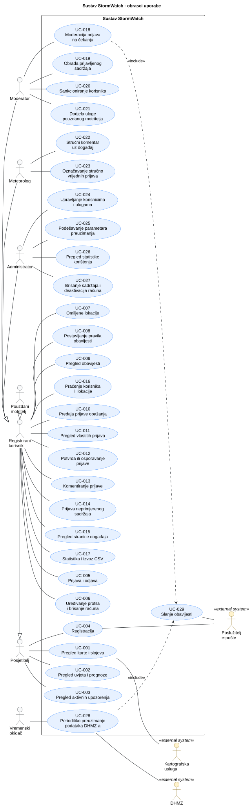

# 3. Obrasci uporabe

## 3.1 Dijagram obrazaca uporabe

**Slika 3.1. Dijagram obrazaca uporabe sustava StormWatch**

**PlantUML izvor:** [izvor](./puml/3-1-stormwatch-system-UC.puml)

## 3.2 Specifikacije obrazaca uporabe

Ključni obrasci uporabe (UC-001, UC-004, UC-008, UC-010, UC-012, UC-018, UC-028) opisani su detaljno; ostali kratko. Oznake PR-xx i P-xx su poslovna pravila i parametri iz odjeljka [2.1](2-Analiza-zahtjeva.md#21-funkcijski-zahtjevi).

### UC-001: Pregled karte i slojeva

| Element specifikacije             | Opis                                                                                                                                                                                                                                                                                                                                                                                                                                                                                                       |
| :-------------------------------- | :--------------------------------------------------------------------------------------------------------------------------------------------------------------------------------------------------------------------------------------------------------------------------------------------------------------------------------------------------------------------------------------------------------------------------------------------------------------------------------------------------------- |
| **Primarni akter**                | A-01 Posjetitelj (i svi akteri koji ga nasljeđuju); sekundarni: A-09 Kartografska usluga                                                                                                                                                                                                                                                                                                                                                                                                                   |
| **Povezani zahtjevi**             | F-014 – F-019, F-022, F-071                                                                                                                                                                                                                                                                                                                                                                                                                                                                                |
| **Preduvjeti**                    | Postoji barem jedno uspješno preuzimanje podataka DHMZ-a.                                                                                                                                                                                                                                                                                                                                                                                                                                                  |
| **Glavni uspješni tok**           | 1. Korisnik otvara naslovnicu. 2. Sustav prikazuje kartu Hrvatske s uključenim slojevima mjernih postaja i upozorenja te vrijeme posljednjeg preuzimanja. 3. Korisnik pomiče i zumira kartu na željeno područje. 4. Korisnik uključuje sloj prijava. 5. Sustav prikazuje prijave koje korisnik smije vidjeti (PR-10). 6. Korisnik odabire mjernu postaju. 7. Sustav prikazuje naziv postaje, vrijeme mjerenja i posljednja mjerenja, uz navod izvora DHMZ.                               |
| **Alternativni tokovi / Iznimke** | **2a — Kartografska usluga nije dostupna:** sustav prikazuje poruku i popis aktivnih upozorenja u tekstualnom obliku. **2b — Izvor DHMZ-a nije dostupan:** sustav prikazuje posljednje pohranjene podatke s vremenom mjerenja. **4a — Odabran filtar:** korisnik filtrira prijave po vrsti pojave ili razdoblju; sustav prikazuje samo odgovarajuće prijave, a ako ih nema, poruku „Nema prijava za odabrani filtar”. **5a — Korisnik nije prijavljen:** sustav prikazuje samo potvrđene prijave. |
| **Posljedice (ishod)**            | Podaci se ne mijenjaju; korisnik vidi službene podatke i prijave za odabrano područje. Nove prijave pojavljuju se bez osvježavanja stranice.                                                                                                                                                                                                                                                                                                                                                               |

### UC-002: Pregled trenutačnih uvjeta i prognoze za mjesto

| Element specifikacije             | Opis                                                                                                                                                                                            |
| :-------------------------------- | :---------------------------------------------------------------------------------------------------------------------------------------------------------------------------------------------- |
| **Primarni akter**                | A-01 Posjetitelj                                                                                                                                                                                |
| **Povezani zahtjevi**             | F-015, F-020                                                                                                                                                                                    |
| **Preduvjeti**                    | Pohranjeni su podaci DHMZ-a.                                                                                                                                                                    |
| **Glavni uspješni tok**           | 1. Korisnik odabire mjesto na karti ili ga traži po nazivu. 2. Sustav prikazuje mjerenja najbliže postaje i prognozu najbližeg mjesta za koje DHMZ objavljuje prognozu, uz naziv tog mjesta. |
| **Alternativni tokovi / Iznimke** | **2a — Nema prognoze u blizini:** sustav prikazuje samo mjerenja i poruku da prognoza nije dostupna.                                                                                            |
| **Posljedice (ishod)**            | Podaci se ne mijenjaju.                                                                                                                                                                         |

### UC-003: Pregled aktivnih upozorenja

| Element specifikacije             | Opis                                                                                                                                                                                              |
| :-------------------------------- | :------------------------------------------------------------------------------------------------------------------------------------------------------------------------------------------------ |
| **Primarni akter**                | A-01 Posjetitelj                                                                                                                                                                                  |
| **Povezani zahtjevi**             | F-016, F-021                                                                                                                                                                                      |
| **Preduvjeti**                    | Pohranjena su upozorenja DHMZ-a.                                                                                                                                                                  |
| **Glavni uspješni tok**           | 1. Korisnik otvara popis upozorenja. 2. Sustav prikazuje upozorenja čije razdoblje važenja obuhvaća trenutačno vrijeme, s regijom, vrstom pojave, razinom (boja i tekst) i razdobljem važenja. |
| **Alternativni tokovi / Iznimke** | **2a — Nema aktivnih upozorenja:** sustav prikazuje „Nema aktivnih upozorenja”.                                                                                                                   |
| **Posljedice (ishod)**            | Podaci se ne mijenjaju.                                                                                                                                                                           |

### UC-004: Registracija

| Element specifikacije             | Opis                                                                                                                                                                                                                                                                                                                                                                                                                                                                            |
| :-------------------------------- | :------------------------------------------------------------------------------------------------------------------------------------------------------------------------------------------------------------------------------------------------------------------------------------------------------------------------------------------------------------------------------------------------------------------------------------------------------------------------------ |
| **Primarni akter**                | A-01 Posjetitelj; sekundarni: A-10 Poslužitelj e-pošte                                                                                                                                                                                                                                                                                                                                                                                                                          |
| **Povezani zahtjevi**             | F-001, F-002                                                                                                                                                                                                                                                                                                                                                                                                                                                                    |
| **Preduvjeti**                    | Posjetitelj nije prijavljen.                                                                                                                                                                                                                                                                                                                                                                                                                                                    |
| **Glavni uspješni tok**           | 1. Posjetitelj odabire „Registracija”. 2. Sustav prikazuje obrazac: korisničko ime, e-pošta, lozinka i potvrda obavijesti o privatnosti. 3. Posjetitelj unosi podatke i potvrđuje. 4. Sustav provjerava jedinstvenost korisničkog imena i e-pošte te pravilo lozinke (PR-15). 5. Sustav stvara račun u stanju „nepotvrđen” i šalje poveznicu za potvrdu na adresu e-pošte. 6. Posjetitelj otvara poveznicu. 7. Sustav aktivira račun i nudi prijavu u sustav. |
| **Alternativni tokovi / Iznimke** | **4a — Zauzeto korisničko ime ili e-pošta:** sustav traži ispravak; račun se ne stvara. **4b — Lozinka ne zadovoljava PR-15:** sustav prikazuje pravilo i traži novu lozinku. **4c — Obavijest o privatnosti nije potvrđena:** registracija nije moguća. **5a — Slanje e-pošte nije uspjelo:** sustav nudi ponovno slanje poveznice. **6a — Poveznica je istekla (P-01):** račun ostaje nepotvrđen; sustav nudi novu poveznicu.                                     |
| **Posljedice (ishod)**            | Račun je aktivan i korisnik se može prijaviti u sustav.                                                                                                                                                                                                                                                                                                                                                                                                                         |

### UC-005: Prijava i odjava

| Element specifikacije             | Opis                                                                                                                                                                                                                                                                      |
| :-------------------------------- | :------------------------------------------------------------------------------------------------------------------------------------------------------------------------------------------------------------------------------------------------------------------------ |
| **Primarni akter**                | A-02 Registrirani korisnik                                                                                                                                                                                                                                                |
| **Povezani zahtjevi**             | F-003 – F-007                                                                                                                                                                                                                                                             |
| **Preduvjeti**                    | Korisnik ima aktivan račun.                                                                                                                                                                                                                                               |
| **Glavni uspješni tok**           | 1. Korisnik unosi korisničko ime (ili e-poštu) i lozinku. 2. Sustav provjerava podatke i izdaje pristupni token prema OAuth 2.0. 3. Korisniku su dostupne funkcije za registrirane korisnike. 4. Korisnik se odjavljuje; sustav poništava token za osvježavanje. |
| **Alternativni tokovi / Iznimke** | **2a — Neispravni podaci:** poruka koja ne otkriva postoji li račun. **2b — Šesti neuspjeli pokušaj u 15 min:** račun je zaključan 15 min (NF-16). **1a — Zaboravljena lozinka:** korisnik traži poveznicu za novu lozinku na potvrđenu e-poštu (F-006).            |
| **Posljedice (ishod)**            | Korisnik je prijavljen (ima valjan token) ili odjavljen.                                                                                                                                                                                                                  |

### UC-006: Uređivanje profila i brisanje računa

| Element specifikacije             | Opis                                                                                                                                                                                                 |
| :-------------------------------- | :--------------------------------------------------------------------------------------------------------------------------------------------------------------------------------------------------- |
| **Primarni akter**                | A-02 Registrirani korisnik                                                                                                                                                                           |
| **Povezani zahtjevi**             | F-008, F-023                                                                                                                                                                                         |
| **Preduvjeti**                    | Korisnik je prijavljen.                                                                                                                                                                              |
| **Glavni uspješni tok**           | 1. Korisnik otvara svoj profil i mijenja fotografiju ili kratak opis. 2. Sustav provjerava duljinu opisa (P-03) i fotografiju (NF-18) i sprema promjene.                                          |
| **Alternativni tokovi / Iznimke** | **1a — Brisanje računa:** korisnik potvrđuje brisanje; sustav briše osobne podatke, a prijave ostaju uz autora „izbrisani korisnik”. **2a — Neispravan unos:** sustav odbija spremanje uz poruku. |
| **Posljedice (ishod)**            | Profil je ažuriran ili je račun obrisan.                                                                                                                                                             |

### UC-007: Upravljanje omiljenim lokacijama i pregled „Lokacije”

| Element specifikacije             | Opis                                                                                                                                                                                                                                                                             |
| :-------------------------------- | :------------------------------------------------------------------------------------------------------------------------------------------------------------------------------------------------------------------------------------------------------------------------------- |
| **Primarni akter**                | A-02 Registrirani korisnik                                                                                                                                                                                                                                                       |
| **Povezani zahtjevi**             | F-024, F-025                                                                                                                                                                                                                                                                     |
| **Preduvjeti**                    | Korisnik je prijavljen.                                                                                                                                                                                                                                                          |
| **Glavni uspješni tok**           | 1. Korisnik odabire točku na karti ili traži mjesto i upisuje naziv lokacije. 2. Sustav sprema lokaciju. 3. Korisnik otvara pregled „Lokacije”. 4. Sustav za svaku lokaciju prikazuje mjerenja najbliže postaje s udaljenošću, prognozu i aktivna upozorenja za regiju. |
| **Alternativni tokovi / Iznimke** | **2a — Dosegnut najveći broj lokacija (P-04):** sustav ne sprema lokaciju i prikazuje poruku. **4a — Nema upozorenja:** uz lokaciju piše „Nema aktivnih upozorenja”.                                                                                                          |
| **Posljedice (ishod)**            | Omiljena lokacija je spremljena i vidljiva samo korisniku (NF-21).                                                                                                                                                                                                               |

### UC-008: Postavljanje pravila obavijesti

| Element specifikacije             | Opis                                                                                                                                                                                                                                                                                                                                                                                                                                 |
| :-------------------------------- | :----------------------------------------------------------------------------------------------------------------------------------------------------------------------------------------------------------------------------------------------------------------------------------------------------------------------------------------------------------------------------------------------------------------------------------- |
| **Primarni akter**                | A-02 Registrirani korisnik                                                                                                                                                                                                                                                                                                                                                                                                           |
| **Povezani zahtjevi**             | F-024, F-028, F-029                                                                                                                                                                                                                                                                                                                                                                                                                  |
| **Preduvjeti**                    | Korisnik je prijavljen i ima barem jednu omiljenu lokaciju.                                                                                                                                                                                                                                                                                                                                                                          |
| **Glavni uspješni tok**           | 1. Korisnik otvara postavke obavijesti. 2. Sustav prikazuje postojeća pravila i omiljene lokacije. 3. Korisnik odabire „Novo pravilo” i omiljenu lokaciju. 4. Korisnik odabire vrstu pravila: upozorenje DHMZ-a s najnižom razinom (narančasta ili crvena) ili potvrđena prijava s vrstom pojave i polumjerom. 5. Korisnik sprema pravilo. 6. Sustav provjerava i pohranjuje pravilo; od tada ga provjerava u UC-029. |
| **Alternativni tokovi / Iznimke** | **2a — Korisnik nema omiljenih lokacija:** sustav nudi dodavanje lokacije (UC-007). **4a — Polumjer izvan raspona P-05:** sustav traži ispravak. **6a — Isto pravilo već postoji:** sustav ne stvara duplikat i o tome obavještava korisnika.                                                                                                                                                                                  |
| **Posljedice (ishod)**            | Pravilo je spremljeno; korisnik dobiva obavijest kad se uvjet ispuni.                                                                                                                                                                                                                                                                                                                                                                |

### UC-009: Pregled obavijesti

| Element specifikacije             | Opis                                                                                                                                                                                                                                                                            |
| :-------------------------------- | :------------------------------------------------------------------------------------------------------------------------------------------------------------------------------------------------------------------------------------------------------------------------------ |
| **Primarni akter**                | A-02 Registrirani korisnik                                                                                                                                                                                                                                                      |
| **Povezani zahtjevi**             | F-030, F-031                                                                                                                                                                                                                                                                    |
| **Preduvjeti**                    | Korisnik je prijavljen.                                                                                                                                                                                                                                                         |
| **Glavni uspješni tok**           | 1. Korisnik vidi crvenu oznaku s brojem nepročitanih obavijesti i otvara pregled „Obavijesti”. 2. Sustav prikazuje obavijesti od najnovije. 3. Korisnik otvara obavijest; sustav je označava pročitanom, smanjuje broj i otvara povezanu prijavu, događaj ili upozorenje. |
| **Alternativni tokovi / Iznimke** | **3a — Povezana prijava je u međuvremenu odbijena ili obrisana:** sustav prikazuje poruku da sadržaj više nije dostupan.                                                                                                                                                        |
| **Posljedice (ishod)**            | Obavijest je označena kao pročitana.                                                                                                                                                                                                                                            |

### UC-010: Predaja prijave opažanja

| Element specifikacije             | Opis                                                                                                                                                                                                                                                                                                                                                                                                                                                                                                                                                                                                                                                                                                                                                                                                                                                                                                                                                                   |
| :-------------------------------- | :--------------------------------------------------------------------------------------------------------------------------------------------------------------------------------------------------------------------------------------------------------------------------------------------------------------------------------------------------------------------------------------------------------------------------------------------------------------------------------------------------------------------------------------------------------------------------------------------------------------------------------------------------------------------------------------------------------------------------------------------------------------------------------------------------------------------------------------------------------------------------------------------------------------------------------------------------------------------- |
| **Primarni akter**                | A-02 Registrirani korisnik (inačica: A-03 Pouzdani motritelj)                                                                                                                                                                                                                                                                                                                                                                                                                                                                                                                                                                                                                                                                                                                                                                                                                                                                                                          |
| **Povezani zahtjevi**             | F-033 – F-038, F-044, F-046, F-058, F-059                                                                                                                                                                                                                                                                                                                                                                                                                                                                                                                                                                                                                                                                                                                                                                                                                                                                                                                              |
| **Preduvjeti**                    | Korisnik je prijavljen, nema zabranu objavljivanja i nije premašio ograničenje broja prijava (NF-17).                                                                                                                                                                                                                                                                                                                                                                                                                                                                                                                                                                                                                                                                                                                                                                                                                                                                  |
| **Glavni uspješni tok**           | 1. Korisnik odabire „Nova prijava”. 2. Sustav prikazuje obrazac s unaprijed popunjenim vremenom opažanja i lokacijom dobivenom putem GPS-a. 3. Korisnik odabire vrstu pojave. 4. Sustav prikazuje ljestvicu intenziteta za odabranu vrstu (za tuču: grašak, lješnjak, orah, jaje). 5. Korisnik odabire intenzitet i procjenu štete, dodaje jednu ili više fotografija i po želji opis. 6. Korisnik potvrđuje predaju. 7. Sustav provjerava obavezne podatke, vrijeme opažanja (PR-12) i fotografije (NF-18). 8. Sustav pohranjuje prijavu u stanju „predana” i prikazuje potvrdu zaprimanja. 9. Sustav uklanja EXIF metapodatke, pridružuje mjerenje najbliže postaje (PR-11) i pridružuje prijavu događaju (PR-06). 10. Sustav postavlja stanje „na čekanju” i prikazuje prijavu ostalim registriranim korisnicima i moderatoru regije.                                                                                                    |
| **Alternativni tokovi / Iznimke** | **2a — Pristup lokaciji nije dopušten ili GPS nije dostupan:** sustav traži odabir lokacije na karti; tok se nastavlja u koraku 3. **7a — Nedostaje obavezan podatak ili je vrijeme opažanja izvan dopuštenog raspona:** sustav označava polja, zadržava unos i ne pohranjuje prijavu; korisnik ispravlja i ponavlja korak 6. **7b — Fotografija nije podržanog formata ili je prevelika:** sustav je odbija uz poruku i zadržava ostale podatke. **7c — Zabrana objavljivanja ili premašeno ograničenje:** sustav odbija predaju uz poruku. **8a — Pohrana nije uspjela:** sustav prikazuje obavijest o neuspjehu, ne prikazuje lažnu potvrdu i zadržava unos za ponovni pokušaj. **9a — Nema mjerenja postaje unutar P-12 i P-13:** uz prijavu piše „Nema službenog mjerenja za vrijeme opažanja”. **10a — Autor je pouzdani motritelj:** sustav postavlja stanje „potvrđena”, označava prijavu posebnom oznakom i ne stavlja je u red moderacije. |
| **Posljedice (ishod)**            | Prijava je trajno pohranjena (NF-10) u stanju „na čekanju” ili „potvrđena”; autor je vidi na pregledu „Prijave”, a ostali korisnici na karti prema PR-10. Pratitelji autora i lokacije dobivaju obavijest (F-030).                                                                                                                                                                                                                                                                                                                                                                                                                                                                                                                                                                                                                                                                                                                                                     |

### UC-011: Pregled vlastitih prijava

| Element specifikacije             | Opis                                                                                                                                                |
| :-------------------------------- | :-------------------------------------------------------------------------------------------------------------------------------------------------- |
| **Primarni akter**                | A-02 Registrirani korisnik                                                                                                                          |
| **Povezani zahtjevi**             | F-038, F-046 – F-048                                                                                                                                |
| **Preduvjeti**                    | Korisnik je prijavljen.                                                                                                                             |
| **Glavni uspješni tok**           | 1. Korisnik otvara pregled „Prijave”. 2. Sustav prikazuje sve njegove prijave od najnovije, sa stanjem uz svaku; potvrđene imaju oznaku potvrde. |
| **Alternativni tokovi / Iznimke** | **2a — Prijava je odbijena:** uz prijavu je prikazano obrazloženje moderatora; drugi korisnici je ne vide (F-047).                                  |
| **Posljedice (ishod)**            | Podaci se ne mijenjaju.                                                                                                                             |

### UC-012: Potvrda ili osporavanje prijave

| Element specifikacije             | Opis                                                                                                                                                                                                                                                                                                                                                                                                                                                                                                                |
| :-------------------------------- | :------------------------------------------------------------------------------------------------------------------------------------------------------------------------------------------------------------------------------------------------------------------------------------------------------------------------------------------------------------------------------------------------------------------------------------------------------------------------------------------------------------------ |
| **Primarni akter**                | A-02 Registrirani korisnik                                                                                                                                                                                                                                                                                                                                                                                                                                                                                          |
| **Povezani zahtjevi**             | F-039 – F-041, F-056                                                                                                                                                                                                                                                                                                                                                                                                                                                                                                |
| **Preduvjeti**                    | Korisnik je prijavljen; prijava je u stanju „na čekanju” ili „potvrđena”; korisnik nije autor prijave.                                                                                                                                                                                                                                                                                                                                                                                                              |
| **Glavni uspješni tok**           | 1. Korisnik otvara prijavu na karti, na stranici događaja ili iz obavijesti. 2. Sustav prikazuje prijavu s fotografijama, mjerenjem najbliže postaje, brojem potvrda i osporavanja te ocjenom vjerodostojnosti. 3. Korisnik odabire „I ja to vidim” ili „Kod mene nije tako”. 4. Sustav bilježi glas. 5. Sustav ponovno izračunava ocjenu vjerodostojnosti (PR-05) i ažurira reputaciju autora (PR-07). 6. Sustav prikazuje novu ocjenu i broj glasova svim korisnicima koji imaju prijavu otvorenu. |
| **Alternativni tokovi / Iznimke** | **3a — Korisnik nije prijavljen:** sustav ga pri pokušaju glasanja preusmjerava na prijavu u sustav. **3b — Korisnik je autor prijave:** gumbi za glasanje nisu dostupni. **3c — Korisnik je već glasao:** odabir drugog gumba mijenja glas, a ponovni odabir istog gumba povlači glas (PR-04). **4a — Prijava je u međuvremenu odbijena ili obrisana:** sustav ne bilježi glas i obavještava korisnika.                                                                                                   |
| **Posljedice (ishod)**            | Glas je zabilježen, a ocjena vjerodostojnosti i reputacija autora su ažurirane.                                                                                                                                                                                                                                                                                                                                                                                                                                     |

### UC-013: Komentiranje prijave

| Element specifikacije             | Opis                                                                                                                                                            |
| :-------------------------------- | :-------------------------------------------------------------------------------------------------------------------------------------------------------------- |
| **Primarni akter**                | A-02 Registrirani korisnik                                                                                                                                      |
| **Povezani zahtjevi**             | F-042                                                                                                                                                           |
| **Preduvjeti**                    | Korisnik je prijavljen i nema zabranu objavljivanja; prijava mu je vidljiva.                                                                                    |
| **Glavni uspješni tok**           | 1. Korisnik upisuje komentar uz prijavu i objavljuje ga. 2. Sustav sprema komentar s autorom i vremenom i prikazuje ga ostalim korisnicima bez osvježavanja. |
| **Alternativni tokovi / Iznimke** | **1a — Komentar je dulji od P-17 ili je premašeno ograničenje (NF-17):** sustav odbija objavu uz poruku.                                                        |
| **Posljedice (ishod)**            | Komentar je objavljen.                                                                                                                                          |

### UC-014: Prijava neprimjerenog sadržaja

| Element specifikacije             | Opis                                                                                                                                 |
| :-------------------------------- | :----------------------------------------------------------------------------------------------------------------------------------- |
| **Primarni akter**                | A-02 Registrirani korisnik                                                                                                           |
| **Povezani zahtjevi**             | F-043                                                                                                                                |
| **Preduvjeti**                    | Korisnik je prijavljen; sadržaj (prijava ili komentar) mu je vidljiv.                                                                |
| **Glavni uspješni tok**           | 1. Korisnik odabire „Prijavi sadržaj” i razlog. 2. Sustav bilježi prijavu sadržaja i stavlja je u red moderatora regije (UC-019). |
| **Alternativni tokovi / Iznimke** | **2a — Korisnik je već prijavio isti sadržaj:** sustav ne bilježi duplikat.                                                          |
| **Posljedice (ishod)**            | Sadržaj je u redu za obradu moderatora.                                                                                              |

### UC-015: Pregled stranice događaja

| Element specifikacije             | Opis                                                                                                                                                                                                                                 |
| :-------------------------------- | :----------------------------------------------------------------------------------------------------------------------------------------------------------------------------------------------------------------------------------- |
| **Primarni akter**                | A-02 Registrirani korisnik                                                                                                                                                                                                           |
| **Povezani zahtjevi**             | F-044, F-045                                                                                                                                                                                                                         |
| **Preduvjeti**                    | Postoji događaj (barem P-19 prijava grupiranih prema PR-06).                                                                                                                                                                         |
| **Glavni uspješni tok**           | 1. Korisnik otvara događaj (npr. „Tuča, Đakovo, 14. 7. 2026.”) s karte ili iz prijave. 2. Sustav prikazuje stručni komentar meteorologa na vrhu, a zatim sve prijave, fotografije i raspravu koje korisnik smije vidjeti (PR-10). |
| **Alternativni tokovi / Iznimke** | **2a — Gledatelj je posjetitelj:** prikazuju se samo potvrđene prijave.                                                                                                                                                              |
| **Posljedice (ishod)**            | Podaci se ne mijenjaju.                                                                                                                                                                                                              |

### UC-016: Praćenje korisnika ili lokacije

| Element specifikacije             | Opis                                                                                                                                                                               |
| :-------------------------------- | :--------------------------------------------------------------------------------------------------------------------------------------------------------------------------------- |
| **Primarni akter**                | A-02 Registrirani korisnik                                                                                                                                                         |
| **Povezani zahtjevi**             | F-026, F-027, F-030                                                                                                                                                                |
| **Preduvjeti**                    | Korisnik je prijavljen.                                                                                                                                                            |
| **Glavni uspješni tok**           | 1. Korisnik na profilu drugog korisnika ili na karti odabire „Prati” (za lokaciju i polumjer). 2. Sustav sprema praćenje i od tada šalje obavijesti o novim prijavama (UC-029). |
| **Alternativni tokovi / Iznimke** | **1a — Polumjer izvan raspona P-05:** sustav traži ispravak. **1b — Prekid praćenja:** korisnik odabire „Prestani pratiti”; obavijesti se više ne šalju.                        |
| **Posljedice (ishod)**            | Praćenje je spremljeno ili prekinuto.                                                                                                                                              |

### UC-017: Pregled statistike i izvoz CSV

| Element specifikacije             | Opis                                                                                                                                                                                                                                                                                         |
| :-------------------------------- | :------------------------------------------------------------------------------------------------------------------------------------------------------------------------------------------------------------------------------------------------------------------------------------------- |
| **Primarni akter**                | A-02 Registrirani korisnik                                                                                                                                                                                                                                                                   |
| **Povezani zahtjevi**             | F-062 – F-064                                                                                                                                                                                                                                                                                |
| **Preduvjeti**                    | Korisnik je prijavljen (pitanje O-13).                                                                                                                                                                                                                                                       |
| **Glavni uspješni tok**           | 1. Korisnik otvara pregled „Statistika” i odabire vrstu pojave, regiju i razdoblje. 2. Sustav prikazuje arhivu događaja i grafikon učestalosti po regijama i mjesecima s tablicom istih vrijednosti. 3. Korisnik odabire izvoz; sustav izrađuje datoteku CSV s istim zapisima (NF-32). |
| **Alternativni tokovi / Iznimke** | **2a — Nema događaja za filtar:** sustav prikazuje poruku i ne nudi prazan izvoz.                                                                                                                                                                                                            |
| **Posljedice (ishod)**            | Podaci se ne mijenjaju; korisnik ima izvezenu datoteku. Odbijene prijave nisu uključene.                                                                                                                                                                                                     |

### UC-018: Moderacija prijava na čekanju

| Element specifikacije             | Opis                                                                                                                                                                                                                                                                                                                                                                                                                                                                                                                                                                                                                                                       |
| :-------------------------------- | :--------------------------------------------------------------------------------------------------------------------------------------------------------------------------------------------------------------------------------------------------------------------------------------------------------------------------------------------------------------------------------------------------------------------------------------------------------------------------------------------------------------------------------------------------------------------------------------------------------------------------------------------------------- |
| **Primarni akter**                | A-04 Moderator                                                                                                                                                                                                                                                                                                                                                                                                                                                                                                                                                                                                                                             |
| **Povezani zahtjevi**             | F-046 – F-051, F-053, F-056                                                                                                                                                                                                                                                                                                                                                                                                                                                                                                                                                                                                                                |
| **Preduvjeti**                    | Korisnik je prijavljen s ulogom moderatora za barem jednu regiju.                                                                                                                                                                                                                                                                                                                                                                                                                                                                                                                                                                                          |
| **Glavni uspješni tok**           | 1. Moderator otvara pregled „Moderacija”. 2. Sustav prikazuje prijave na čekanju iz regija moderatora, poredane po vremenu predaje, uz ocjenu vjerodostojnosti. 3. Moderator odabire prijavu. 4. Sustav prikazuje fotografije, opis, mjerenje najbliže postaje, glasove, komentare i aktivna upozorenja DHMZ-a za regiju. 5. Moderator odabire „Potvrdi”. 6. Sustav provjerava ovlasti i regiju, postavlja stanje „potvrđena”, bilježi moderatora i vrijeme, ažurira reputaciju autora i ističe prijavu oznakom potvrde. 7. Sustav obavještava autora i korisnike čija su pravila obavijesti ispunjena (UC-029).                         |
| **Alternativni tokovi / Iznimke** | **2a — Nema prijava na čekanju:** sustav prikazuje „Nema prijava na čekanju”. **5a — Odbijanje:** moderator odabire „Odbij”; sustav traži obrazloženje (PR-13), postavlja stanje „odbijena”, skriva prijavu prema PR-10 i autoru šalje obrazloženje. **5b — Brisanje:** moderator odabire „Obriši” i potvrđuje; sustav uklanja prijavu (F-053). **5c — Moderator odustaje:** vraća se na popis; prijava ostaje na čekanju. **6a — Drugi moderator je u međuvremenu obradio prijavu:** sustav o tome obavještava i osvježava popis. **6b — Prijava je izvan regije moderatora:** sustav odbija radnju (NF-14); stanje ostaje nepromijenjeno. |
| **Posljedice (ishod)**            | Prijava je potvrđena (vidljiva posjetiteljima) ili odbijena (vidljiva samo autoru, moderatorima i administratoru); autor je obaviješten.                                                                                                                                                                                                                                                                                                                                                                                                                                                                                                                   |

### UC-019: Obrada prijavljenog sadržaja

| Element specifikacije             | Opis                                                                                                                                                                                                    |
| :-------------------------------- | :------------------------------------------------------------------------------------------------------------------------------------------------------------------------------------------------------ |
| **Primarni akter**                | A-04 Moderator                                                                                                                                                                                          |
| **Povezani zahtjevi**             | F-052, F-053                                                                                                                                                                                            |
| **Preduvjeti**                    | Moderator je prijavljen; postoji prijavljeni sadržaj iz njegove regije.                                                                                                                                 |
| **Glavni uspješni tok**           | 1. Moderator na pregledu „Moderacija” otvara prijavljeni sadržaj s razlozima i brojem prijava. 2. Moderator briše sadržaj ili odbacuje prijavu sadržaja kao neosnovanu. 3. Sustav provodi odluku. |
| **Alternativni tokovi / Iznimke** | **2a — Uz brisanje potrebna je i sankcija:** moderator nastavlja u UC-020.                                                                                                                              |
| **Posljedice (ishod)**            | Sadržaj je obrisan (vidljiv samo administratoru) ili ostaje objavljen, a prijava sadržaja je zatvorena.                                                                                                 |

### UC-020: Sankcioniranje korisnika

| Element specifikacije             | Opis                                                                                                                                                                             |
| :-------------------------------- | :------------------------------------------------------------------------------------------------------------------------------------------------------------------------------- |
| **Primarni akter**                | A-04 Moderator                                                                                                                                                                   |
| **Povezani zahtjevi**             | F-054, F-055                                                                                                                                                                     |
| **Preduvjeti**                    | Moderator je prijavljen.                                                                                                                                                         |
| **Glavni uspješni tok**           | 1. Moderator na profilu korisnika odabire „Upozori” ili „Zabrani objavljivanje” s trajanjem (P-16). 2. Sustav bilježi sankciju uz račun i šalje korisniku obavijest (UC-029). |
| **Alternativni tokovi / Iznimke** | **2a — Istek zabrane:** sustav ukida zabranu bez ručne radnje.                                                                                                                   |
| **Posljedice (ishod)**            | Korisnik je upozoren ili tijekom zabrane ne može predavati prijave ni komentare (PR-14).                                                                                         |

### UC-021: Dodjela uloge pouzdanog motritelja

| Element specifikacije             | Opis                                                                                                                                                                                                                 |
| :-------------------------------- | :------------------------------------------------------------------------------------------------------------------------------------------------------------------------------------------------------------------- |
| **Primarni akter**                | A-04 Moderator                                                                                                                                                                                                       |
| **Povezani zahtjevi**             | F-056 – F-059                                                                                                                                                                                                        |
| **Preduvjeti**                    | Moderator je prijavljen; korisnik ima reputaciju ≥ P-10.                                                                                                                                                             |
| **Glavni uspješni tok**           | 1. Moderator otvara profil korisnika s reputacijom i odabire „Dodijeli ulogu pouzdanog motritelja”. 2. Sustav dodjeljuje ulogu; od tada se prijave tog korisnika potvrđuju bez moderacije i imaju posebnu oznaku. |
| **Alternativni tokovi / Iznimke** | **1a — Reputacija je ispod praga:** mogućnost nije dostupna.                                                                                                                                                         |
| **Posljedice (ishod)**            | Korisnik ima ulogu pouzdanog motritelja.                                                                                                                                                                             |

### UC-022: Objava stručnog komentara uz događaj

| Element specifikacije             | Opis                                                                                                                                                                                                                        |
| :-------------------------------- | :-------------------------------------------------------------------------------------------------------------------------------------------------------------------------------------------------------------------------- |
| **Primarni akter**                | A-05 Meteorolog                                                                                                                                                                                                             |
| **Povezani zahtjevi**             | F-060                                                                                                                                                                                                                       |
| **Preduvjeti**                    | Meteorolog je prijavljen; događaj postoji.                                                                                                                                                                                  |
| **Glavni uspješni tok**           | 1. Meteorolog na stranici događaja upisuje stručni komentar (npr. o smjeru kretanja olujne ćelije). 2. Sustav sprema komentar i prikazuje ga svim korisnicima istaknuto na vrhu stranice događaja, s imenom meteorologa. |
| **Alternativni tokovi / Iznimke** | **2a — Korisnik nema ulogu meteorologa:** sustav odbija zahtjev (NF-14).                                                                                                                                                    |
| **Posljedice (ishod)**            | Stručni komentar je objavljen uz događaj.                                                                                                                                                                                   |

### UC-023: Označavanje stručno vrijednih prijava

| Element specifikacije             | Opis                                                                                                                                     |
| :-------------------------------- | :--------------------------------------------------------------------------------------------------------------------------------------- |
| **Primarni akter**                | A-05 Meteorolog                                                                                                                          |
| **Povezani zahtjevi**             | F-061                                                                                                                                    |
| **Preduvjeti**                    | Meteorolog je prijavljen.                                                                                                                |
| **Glavni uspješni tok**           | 1. Meteorolog uz prijavu odabire „Vrijedno za analizu”. 2. Sustav dodaje oznaku; prijava se može izdvojiti filtrom u arhivi i izvozu. |
| **Alternativni tokovi / Iznimke** | **1a — Uklanjanje oznake:** meteorolog ponovno odabire istu radnju.                                                                      |
| **Posljedice (ishod)**            | Prijava ima ili nema stručnu oznaku.                                                                                                     |

### UC-024: Upravljanje korisnicima i ulogama

| Element specifikacije             | Opis                                                                                                                                                                                                                                      |
| :-------------------------------- | :---------------------------------------------------------------------------------------------------------------------------------------------------------------------------------------------------------------------------------------- |
| **Primarni akter**                | A-06 Administrator                                                                                                                                                                                                                        |
| **Povezani zahtjevi**             | F-065, F-066                                                                                                                                                                                                                              |
| **Preduvjeti**                    | Administrator je prijavljen. Prvi administratorski račun stvara se pri postavljanju sustava.                                                                                                                                              |
| **Glavni uspješni tok**           | 1. Administrator traži korisnika po korisničkom imenu, e-pošti ili ulozi. 2. Administrator dodjeljuje ili oduzima ulogu moderatora (s regijom) ili meteorologa. 3. Sustav sprema promjenu; vrijedi od sljedećeg zahtjeva korisnika. |
| **Alternativni tokovi / Iznimke** | **2a — Moderator bez regije:** sustav ne dopušta dodjelu dok se ne odabere barem jedna regija.                                                                                                                                            |
| **Posljedice (ishod)**            | Uloge korisnika su ažurirane.                                                                                                                                                                                                             |

### UC-025: Podešavanje parametara preuzimanja DHMZ-a

| Element specifikacije             | Opis                                                                                                                                                                                                |
| :-------------------------------- | :-------------------------------------------------------------------------------------------------------------------------------------------------------------------------------------------------- |
| **Primarni akter**                | A-06 Administrator                                                                                                                                                                                  |
| **Povezani zahtjevi**             | F-067                                                                                                                                                                                               |
| **Preduvjeti**                    | Administrator je prijavljen.                                                                                                                                                                        |
| **Glavni uspješni tok**           | 1. Administrator mijenja interval preuzimanja, adresu izvora ili uključuje i isključuje pojedini izvor. 2. Sustav sprema promjenu i primjenjuje je od sljedećeg ciklusa bez ponovnog pokretanja. |
| **Alternativni tokovi / Iznimke** | **2a — Interval kraći od 10 min:** sustav odbija promjenu (PR-17).                                                                                                                                  |
| **Posljedice (ishod)**            | Parametri preuzimanja su ažurirani.                                                                                                                                                                 |

### UC-026: Pregled statistike korištenja

| Element specifikacije             | Opis                                                                                                                                                    |
| :-------------------------------- | :------------------------------------------------------------------------------------------------------------------------------------------------------ |
| **Primarni akter**                | A-06 Administrator                                                                                                                                      |
| **Povezani zahtjevi**             | F-013, F-068                                                                                                                                            |
| **Preduvjeti**                    | Administrator je prijavljen.                                                                                                                            |
| **Glavni uspješni tok**           | 1. Administrator odabire razdoblje. 2. Sustav prikazuje broj registriranih i aktivnih korisnika, broj prijava po stanju i ishode preuzimanja DHMZ-a. |
| **Alternativni tokovi / Iznimke** | —                                                                                                                                                       |
| **Posljedice (ishod)**            | Podaci se ne mijenjaju.                                                                                                                                 |

### UC-027: Brisanje sadržaja i deaktivacija računa

| Element specifikacije             | Opis                                                                                                                                    |
| :-------------------------------- | :-------------------------------------------------------------------------------------------------------------------------------------- |
| **Primarni akter**                | A-06 Administrator                                                                                                                      |
| **Povezani zahtjevi**             | F-069, F-070                                                                                                                            |
| **Preduvjeti**                    | Administrator je prijavljen.                                                                                                            |
| **Glavni uspješni tok**           | 1. Administrator odabire sadržaj ili korisnički račun i radnju „Obriši” ili „Deaktiviraj”. 2. Sustav traži potvrdu i provodi radnju. |
| **Alternativni tokovi / Iznimke** | **2a — Administrator odustaje:** ništa se ne mijenja.                                                                                   |
| **Posljedice (ishod)**            | Obrisani sadržaj nije vidljiv nijednom korisniku; deaktivirani korisnik ne može se prijaviti, a njegovi tokeni prestaju vrijediti.      |

### UC-028: Periodičko preuzimanje podataka DHMZ-a

| Element specifikacije             | Opis                                                                                                                                                                                                                                                                                                                                                                                                                                                                                                  |
| :-------------------------------- | :---------------------------------------------------------------------------------------------------------------------------------------------------------------------------------------------------------------------------------------------------------------------------------------------------------------------------------------------------------------------------------------------------------------------------------------------------------------------------------------------------- |
| **Primarni akter**                | A-07 Vremenski okidač; sekundarni: A-08 DHMZ                                                                                                                                                                                                                                                                                                                                                                                                                                                          |
| **Povezani zahtjevi**             | F-009 – F-013, F-028                                                                                                                                                                                                                                                                                                                                                                                                                                                                                  |
| **Preduvjeti**                    | Adrese izvora i interval preuzimanja su postavljeni; prošao je interval P-06 od prethodnog preuzimanja.                                                                                                                                                                                                                                                                                                                                                                                               |
| **Glavni uspješni tok**           | 1. Vremenski okidač pokreće preuzimanje. 2. Sustav za svaki uključeni izvor (mjerenja, prognoze, upozorenja) šalje zahtjev DHMZ-u. 3. DHMZ vraća XML dokument. 4. Sustav provjerava i raščlanjuje XML. 5. Sustav pohranjuje nove podatke, uz čuvanje povijesti mjerenja. 6. Sustav bilježi ishod preuzimanja (F-013). 7. Za nova ili pojačana upozorenja sustav pokreće slanje obavijesti (UC-029). 8. Sustav prikazuje osvježene podatke korisnicima koji imaju otvorenu kartu. |
| **Alternativni tokovi / Iznimke** | **1a — Prethodno preuzimanje još traje:** novo se ne pokreće. **3a — Izvor nije dostupan ili vraća pogrešku:** sustav ponavlja zahtjev prema NF-08, a nakon neuspjeha bilježi pogrešku i zadržava postojeće podatke. **4a — XML je neispravan ili promijenjene strukture:** sustav ne mijenja podatke tog izvora i bilježi pogrešku (NF-09). **4b — Podaci nisu noviji od pohranjenih:** sustav ih ne pohranjuje ponovno.                                                                    |
| **Posljedice (ishod)**            | Baza sadrži najnovije dostupne podatke DHMZ-a ili je zabilježen razlog neuspjeha; korisnici za to vrijeme rade s posljednjim pohranjenim podacima.                                                                                                                                                                                                                                                                                                                                                    |

### UC-029: Slanje obavijesti

| Element specifikacije             | Opis                                                                                                                                                                                                                                             |
| :-------------------------------- | :----------------------------------------------------------------------------------------------------------------------------------------------------------------------------------------------------------------------------------------------- |
| **Primarni akter**                | Nema izravnog aktera; uključen je u UC-018 i UC-028. Isto ponašanje pokreću i nova prijava (za pratitelje, UC-010) i sankcija (UC-020). Sekundarni: A-10 Poslužitelj e-pošte                                                                     |
| **Povezani zahtjevi**             | F-028 – F-032                                                                                                                                                                                                                                    |
| **Preduvjeti**                    | Dogodila se promjena koja može ispuniti pravilo obavijesti: novo upozorenje, potvrđena prijava, nova prijava praćenog korisnika ili lokacije, odluka moderatora.                                                                                 |
| **Glavni uspješni tok**           | 1. Sustav pronalazi korisnike čija su pravila ili praćenja ispunjena promjenom. 2. Sustav za svakog korisnika stvara jednu obavijest na pregledu „Obavijesti” i povećava broj nepročitanih. 3. Sustav predaje poruku poslužitelju e-pošte. |
| **Alternativni tokovi / Iznimke** | **2a — Ista promjena ispunjava više pravila istog korisnika:** stvara se jedna obavijest. **3a — Slanje e-pošte nije uspjelo:** obavijest ostaje u aplikaciji, a slanje se ponavlja.                                                          |
| **Posljedice (ishod)**            | Korisnici imaju obavijest u aplikaciji (unutar 60 s) i poruku e-pošte (predanu unutar 2 min, NF-04).                                                                                                                                             |

---

## 3.3 Provjera dosljednosti obrazaca uporabe

| Provjera   | Pitanje za tim                                                                                                              | Rezultat provjere                                                                                              |
| ---------- | --------------------------------------------------------------------------------------------------------------------------- | -------------------------------------------------------------------------------------------------------------- |
| Zahtjev    | Je li svaki važan obrazac uporabe povezan s postojećim zahtjevom?                                                           | Da: svih 29 obrazaca uporabe navodi postojeće zahtjeve iz 2.1.                                                 |
| Akter      | Odgovara li akter naveden ovdje prethodno utvrđenoj ulozi i dopuštenoj interakciji?                                         | Da: primarni akteri su A-01 – A-07 iz 2.3; dionici D-01 – D-03 nisu akteri.                                    |
| Aplikacija | Može li tim demonstrirati opisani glavni rezultat i važnu alternativu ili je opis jasno označen kao trenutačno oblikovanje? | Ne još: aplikacija nije izgrađena, pa su svi opisi **trenutačno oblikovanje**. Ažuriraju se nakon Iteracije 1. |

---
