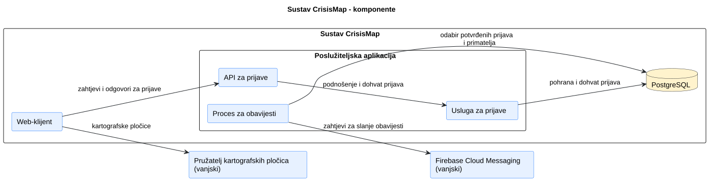
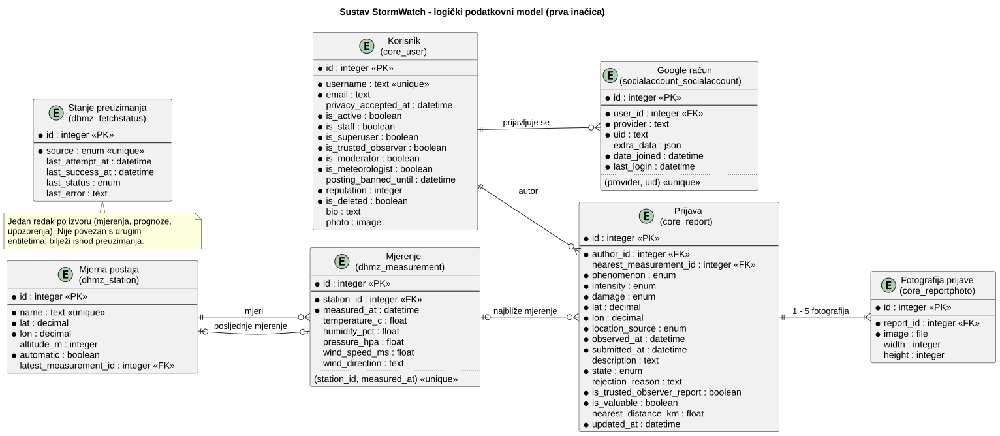
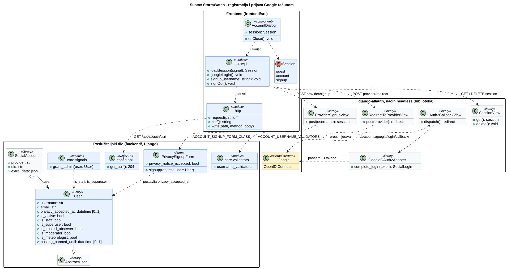

# 4. Arhitektura i oblikovanje

| Arhitekturni pogled | Ključno inženjersko pitanje | Primijenjeni model ili dijagram |
| :--- | :--- | :--- |
| **Strategija rješenja** | Koji stil i temeljne odluke određuju program? | Tablica odluka (odjeljak 4.1) |
| **Struktura podsustava** | Koji su glavni dijelovi i kako komuniciraju? | Dijagram komponenata |
| **Model podataka** | Kako su strukturirani trajni podaci programa? | Relacijski ER dijagram |
| **Struktura koda** | Kako su dodijeljene odgovornosti i ključne klase? | Reprezentativni dijagram razreda |
| **Dinamičko ponašanje** | Kako moduli surađuju pri obradi ključnih transakcija? | sekvencijski dijagram |
| **Stanja sustava** | Kako ključni domenski objekt mijenja svoja stanja? | Dijagram stanja |
| **Fizički razmještaj** | Na kojim se izvršnim čvorovima program izvodi? | Dijagram razmještaja (poglavlje 6) |

---

## 4.1 Ključne arhitekturne odluke

| Odluka | Razmatrana alternativa | Projektno specifično obrazloženje i kompromis |
| --- | --- | --- |
| Jednostranična web aplikacija (React) i jedan poslužiteljski REST API (Django i Django Ninja) nad relacijskom bazom PostgreSQL | Zasebne poslužiteljske usluge, npr. za prijave i za podatke DHMZ-a; dokumentno orijentirana baza | Prijave, korisnici, postaje i mjerenja međusobno su povezani (autor prijave, mjerenje najbliže postaje), pa ih relacijska shema s ograničenjima čuva dosljednima, a Django migracije prate promjene sheme. Jedan Django projekt podijeljen je na aplikacije `core` (korisnici i prijave) i `dhmz` (postaje i mjerenja) koje se postavljaju zajedno; za opseg jednog semestra to je jednostavnije od više usluga. Ugovor između frontenda i API-ja zapisan je u `docs/api/openapi.yaml`. Kompromis: kvar poslužitelja zaustavlja cijelu aplikaciju, a dijelovi se ne mogu skalirati odvojeno. |
| U prvoj inačici prijave potvrđuje i odbija administrator u Django Adminu | Vlastito moderatorsko sučelje u Reactu (UC-016) | Django Admin daje gotove popise, filtre i obrasce za `Report` i `User`, pa je prva inačica mogla zatvoriti tijek prijave bez novog sučelja. Kompromis: moderator po regijama (PR-06, PR-07) još ne postoji, a promjenu stanja može napraviti samo korisnik s administratorskim ovlastima. |
| Prijava Google računom preko biblioteke django-allauth u načinu bez vlastitih stranica (headless), uz sesijski kolačić | Vlastiti pristupni token (npr. JWT) koji poslužitelj izdaje nakon provjere Googleova ID tokena, kako su to prvotno opisivali F-002 i UC-003 | django-allauth provodi tok OAuth 2.0 i OpenID Connect s Googleom, provjerava ID token i vodi registraciju, pa tim ne piše ni ne održava vlastito izdavanje i opoziv tokena. Prijavljeni korisnik dobiva sesijski kolačić `sessionid`, a zahtjevi koji mijenjaju podatke štite se od CSRF-a. Kompromis: frontend i backend moraju dijeliti podrijetlo (lokalno preko Vite proxyja, na Renderu tako što Django poslužuje frontend). F-002, C-02 i UC-003 usklađeni su s ovom odlukom. |
| Administratori se određuju popisom Google adresa u varijabli `ADMIN_EMAILS` | Ručna dodjela ovlasti u bazi ili `createsuperuser` s lozinkom | Sustav ne pohranjuje lozinke (C-02, NF-04), pa se administrator ne može prijaviti obrascem s lozinkom. Korisnik čija je adresa na popisu pri prijavi Google računom dobiva ovlasti administratora, a `/admin/login/` preusmjerava na prijavu u frontendu. Kompromis: novi administrator traži promjenu varijable okruženja i ponovno pokretanje poslužitelja. |
| Podaci DHMZ-a preuzimaju se pri zahtjevu za postajama (lijeno preuzimanje) | Zaseban raspoređivač (cron posao na Renderu ili Celery beat) | Besplatni smještaj na Renderu nema raspoređivač, a zaseban proces povećao bi trošak i složenost postavljanja. Prvi zahtjev za `/api/v1/stations` nakon isteka intervala P-10 pokreće preuzimanje, a uvjetni UPDATE nad tablicom `FetchStatus` osigurava da ga pokrene samo jedan zahtjev. Kompromis: dok nitko ne otvara kartu, podaci se ne osvježavaju, a zahtjev koji pokrene preuzimanje čeka njegov završetak. |
| Fotografije prijave ponovno se kodiraju na poslužitelju (Pillow i pillow-heif) | Spremiti datoteku kako je poslana i provjeriti samo zaglavlje `Content-Type` | Zaglavlje `Content-Type` šalje klijent i lako ga je lažirati, a EXIF fotografije s mobitela često sadrži GPS koordinate i podatke o uređaju (NF-07). Dekodiranje potvrđuje da je datoteka stvarno slika, primjenjuje EXIF orijentaciju i sprema sliku bez metapodataka. HEIC se pretvara u JPEG jer ga preglednici ne prikazuju. Kompromis: obrada troši procesor i memoriju tijekom zahtjeva, a JPEG se ponovno sažima (kvaliteta 90). |
| Mjerenje najbliže postaje određuje se i sprema pri predaji prijave | Tražiti najbližu postaju pri svakom prikazu prijave | PR-08 traži da se odabrano mjerenje naknadno ne mijenja, pa prijava čuva strani ključ na `Measurement` i udaljenost. Udaljenost se računa po velikoj kružnici u Pythonu, nad postajama unutar pravokutnika oko točke prijave, pa PostGIS nije potreban. Kompromis: predaja ne pokreće preuzimanje DHMZ-a, pa prijava ostaje bez mjerenja ako baza nema mjerenje unutar ±60 min. |
| Greške API-ja uz tekst poruke imaju i strojno čitljiv `code` | Samo tekst poruke u polju `detail` | Poruke su na hrvatskom i mogu se mijenjati, a frontend mora pouzdano prepoznati razlog, npr. zabranu objavljivanja (`posting_banned`) ili preveliku fotografiju (`photo_too_large`). Greške validacije ostaju u formatu Django Ninje po poljima, kako propisuje `docs/api/openapi.yaml`. |
| Django u istoj Render web-usluzi poslužuje izgrađeni React frontend (WhiteNoise) | Zasebno statičko web-mjesto na Renderu za frontend i zasebna web-usluga za backend | Prijava sesijskim kolačićem traži da frontend i backend dijele podrijetlo. Na istoj domeni nisu potrebni CORS, `SameSite=None` ni `VITE_API_BASE_URL`, a frontend zove API relativnim putanjama. `backend/build.sh` gradi frontend, a WhiteNoise, koji već poslužuje statičke datoteke Django Admina, poslužuje `frontend/dist` s korijena domene i na `/` vraća `index.html`. Rute `/api/v1/`, `/_allauth/`, `/accounts/` i `/admin/` ostaju Djangove. Kompromis: izgradnja backenda traži Node.js, svaka promjena frontenda ponovno postavlja cijelu uslugu, a frontend i API ne mogu se skalirati odvojeno. |

## 4.2 Gradivni blokovi i UML dijagram komponenata

**Cilj:** Prikazati logičku podjelu programa na komponente, njihova sučelja i vanjske integracije. Dijagram komponenata prikazuje logičku organizaciju, dok dijagram razmještaja prikazuje fizičko izvođenje. Ovaj prikaz ažurirajte kako sustav poprima konačan oblik.

**Dijagram komponenata:** [Ugradite čitljiv UML dijagram komponenata.]  
**PlantUML izvor:** [Poveznica na odgovarajuću `.puml` datoteku.]

| Komponenta | Odgovornost | Razlog za ovu granicu |
| --- | --- | --- |
|  |  |  |

Započnite crtanjem granice oko predloženog sustava. Unutar nje prepoznajte dijelove s različitim odgovornostima; planiranu bazu podataka aplikacije smjestite unutar granice, a usluge trećih strana izvan nje. Važne veze označite podatkom ili uslugom koja njima prolazi. Logička komponenta može biti modul unutar jedne poslužiteljske aplikacije: zaseban pravokutnik ne znači zasebno postavljenu uslugu. Tijekom implementacije ažurirajte dijagram kada se promijene odgovornosti ili veze. U završnoj inačici čitatelj treba moći povezati njegove dijelove s kodom. Dijagram razmještaja odgovara na pitanje gdje se ti dijelovi stvarno izvode.

<strong>Granica sustava, odgovornosti i vanjske ovisnosti</strong>

**Primjer — CrisisMap:** Predložena arhitektura podržava podnošenje prijava kriznih događaja, prikaz na karti i obavijesti o potvrđenim prijavama.

**Slika 4.1. Dijagram komponenata sustava CrisisMap**

**PlantUML izvor:** [izvor](./puml/4-1-crisismap-system-CMP.puml)

| Dio | Odgovornost | Razlog za ovu granicu |
| --- | --- | --- |
| Web-klijent | Prikazuje prijave i prikuplja podatke za novu prijavu. | Korisnička interakcija odvojena je od pravila prijave i trajne pohrane. |
| API za prijave | Prihvaća zahtjeve za rad s prijavama i vraća odgovore. | Odgovornosti izložene putem HTTP-a odvojene su od obrade prijava. |
| Usluga za prijave | Primjenjuje pravila prijave i pristupa pohranjenim prijavama. | Pravila provjere valjanosti i pohrane prijava imaju jasno mjesto odgovornosti. |
| Proces za obavijesti | Određuje korisnike koji trebaju primiti obavijest i traži od vanjskog pružatelja da je pošalje. | Obrada obavijesti odvojena je od odgovaranja na korisnikov zahtjev za prijavu. |

**Analiza primjera:** Vanjska granica odvaja predloženi sustav od pružatelja kartografskih usluga i pružatelja obavijesti. Unutarnja granica grupira API za prijave, uslugu za prijave i proces za obavijesti unutar jedne poslužiteljske aplikacije; njihovi zasebni simboli prikazuju predložene odgovornosti, a ne neovisno postavljene usluge. PostgreSQL pohranjuje podatke aplikacije, dok pružatelj kartografskih usluga osigurava kartografske pločice. Strelice sažimaju ovisnosti, a ne redoslijed transakcije; taj redoslijed prikazuje sekvencijski dijagram. Izostavite proces za obavijesti i Firebase Cloud Messaging ako obavijesti nisu dio odobrenog opsega. Pružatelja prijave u sustav uključite samo ako to zahtijeva odobreni zadatak. Kako implementacija napreduje, ispravite svaku predloženu granicu koja se pokaže netočnom; završni dijagram mora odgovarati onome što je tim izgradio. Jedan koherentan prikaz komponenata korisniji je od nekoliko gotovo jednakih inačica s proturječnim vezama.

## 4.3 Model podataka i oblikovanje razreda

### 4.3.1 ER dijagram i model podataka

**Slika 4.2. Logički podatkovni model prve inačice**

**PlantUML izvor:** [izvor](./puml/4-2-stormwatch-data-ERD.puml)  
**Implementacija:** [`backend/core/models.py`](../backend/core/models.py) (korisnik, prijava, fotografija) i [`backend/dhmz/models.py`](../backend/dhmz/models.py) (postaja, mjerenje, stanje preuzimanja). Tablicu `socialaccount_socialaccount` održava biblioteka django-allauth. Shemu stvaraju Django migracije u `backend/core/migrations/` i `backend/dhmz/migrations/`.

Atributi označeni zvjezdicom obavezni su. Nazivi tablica i stupaca odgovaraju bazi podataka.

- **Korisnik i Google račun.** Korisnik se registrira i prijavljuje isključivo Google računom, pa django-allauth uz zapis u `core_user` sprema vezu s Google računom (`provider` je `google`, a `uid` Googleov identifikator korisnika; par je jedinstven). `privacy_accepted_at` bilježi kada je korisnik pri prvoj prijavi potvrdio obavijest o privatnosti. Oznake `is_trusted_observer`, `is_moderator` i `is_meteorologist` određuju uloge, a `is_staff` i `is_superuser` administratora.
- **Prijava i fotografije.** Prijava ima jednog autora i jednu do pet fotografija; broj fotografija provjerava API pri predaji. Vrsta pojave, intenzitet, šteta, izvor lokacije i stanje fiksne su vrijednosti u kodu (Django `TextChoices`), a ne zasebne tablice. Dva ograničenja u bazi čuvaju pravila prijave: vrijeme opažanja najviše je 24 h prije i 5 min nakon predaje, a intenzitet odgovara pojavi (veličina zrna samo za tuču).
- **Mjerenje uz prijavu.** Pri predaji prijava dobiva strani ključ na mjerenje najbliže postaje i udaljenost do nje (PR-08). Ako takvog mjerenja nema, ključ ostaje prazan.
- **Podaci DHMZ-a.** Postaja se prepoznaje po nazivu jer DHMZ ne objavljuje šifru postaje. `latest_measurement_id` pokazuje na posljednje mjerenje, da popis postaja ne traži najnovije mjerenje za svaku postaju posebno. Par (postaja, termin mjerenja) jedinstven je, pa ponovno preuzimanje istog termina ne stvara duplikat. `dhmz_fetchstatus` ima po jedan redak za svaki izvor i služi za interval preuzimanja P-10 i `GET /api/v1/data-status`.

Dijagram ne prikazuje Djangove tablice za sesije i dozvole, allauthove adrese e-pošte ni stupce `password`, `first_name`, `last_name` i `last_login` naslijeđene iz Djangova korisnika, jer ih aplikacija ne koristi za vlastitu logiku.

### 4.3.2 Reprezentativni UML dijagram razreda

Prikazana je generička funkcionalnost prve inačice: registracija i prijava Google računom (F-001, F-002, UC-003) te dodjela administratorskih ovlasti (F-027). Tim nije pisao vlastiti tok OAuth 2.0, nego je oko biblioteke django-allauth oblikovao nekoliko vlastitih razreda ([4.1](#41-ključne-arhitekturne-odluke)). Razredi biblioteke prikazani su sivo, sa stereotipom «library».

**Slika 4.3. Razredi registracije i prijave Google računom**

**PlantUML izvor:** [izvor](./puml/4-3-stormwatch-auth-CD.puml)  
**Referenca na kod:** frontend [`services/authApi.ts`](../frontend/src/services/authApi.ts), [`services/http.ts`](../frontend/src/services/http.ts) i [`components/AccountDialog.tsx`](../frontend/src/components/AccountDialog.tsx); backend [`core/models.py`](../backend/core/models.py) (`User`), [`core/forms.py`](../backend/core/forms.py), [`core/validators.py`](../backend/core/validators.py), [`core/signals.py`](../backend/core/signals.py), [`config/api.py`](../backend/config/api.py) (`get_csrf`) i postavke django-allautha u [`config/settings.py`](../backend/config/settings.py).

- **Frontend.** `AccountDialog` prikazuje prijavu, dovršetak registracije ili „Moj račun”, ovisno o stanju `Session` (`guest`, `signup`, `account`) koje vraća `authApi.loadSession`. `authApi` poziva headless rute django-allautha: `googleLogin` šalje obrazac na `provider/redirect`, `signup` šalje korisničko ime i potvrdu privatnosti, a `signOut` briše sesiju. Prije svakog zahtjeva koji mijenja podatke `http.csrf` dohvaća kolačić `csrftoken` s `GET /api/v1/auth/csrf`, a `http.write` ga šalje u zaglavlju `X-CSRFToken`.
- **Povratak s Googlea.** Google vraća korisnika na `/accounts/google/login/callback/`, gdje `OAuth2CallbackView` i `GoogleOAuth2Adapter` provjeravaju ID token. Automatska registracija je isključena (`SOCIALACCOUNT_AUTO_SIGNUP = False`), pa za novi Google račun sesija ostaje u stanju `signup` dok korisnik ne odabere korisničko ime.
- **Registracija.** `ProviderSignupView` provjerava korisničko ime pravilom iz `core.validators` (3–30 znakova: slova bez dijakritika, brojke, `_`, `.` i `-`) i poziva `PrivacySignupForm.signup`, koji upisuje `privacy_accepted_at`. Tada nastaju `User` i povezani `SocialAccount`.
- **Administrator.** `core.signals.grant_admin` prima Djangov signal `user_logged_in`: korisnik čija je adresa u `ADMIN_EMAILS` dobiva `is_staff` i `is_superuser`. `/admin/login/` nema obrazac s lozinkom, nego preusmjerava na prijavu u frontendu ([`config/urls.py`](../backend/config/urls.py)).

## 4.4 Ponašanje tijekom izvođenja

**Cilj:** Objasniti jednu važnu interakciju među dijelovima koji se izvode i životni ciklus jednog smislenog objekta. Odaberite primjere koji otkrivaju odluke ili neuspješne putove umjesto izrade dijagrama za svaku CRUD radnju.

### 4.4.1 Reprezentativni UML sekvencijski dijagram

**Cilj:** Prikazati redoslijed poruka za jedan reprezentativni scenarij i odgovore na važnu alternativu.

**Scenarij:** [Naziv interakcije; dodajte UC ID ako postoji.]  
**sekvencijski dijagram:** [Ugradite čitljiv UML sekvencijski dijagram.]  
**PlantUML izvor:** [Poveznica na odgovarajuću `.puml` datoteku.]

<strong>Odabir lokacije, provjera valjanosti i podnošenje prijave</strong>

**Primjer — CrisisMap:** Građanin podnosi prijavu kriznog događaja nakon što ručno odabere lokaciju ili zatraži položaj uređaja. Interakcija prikazuje i što se događa kada je pristup lokaciji odbijen, podaci prijave nisu valjani ili pohrana ne uspije.

**Slika 4.4. Sekvencijski dijagram podnošenja prijave kriznog događaja**

**PlantUML izvor:** [izvor](./puml/4-4-crisismap-report-submission-SD.puml)

**Analiza primjera:** Dva načina odabira lokacije te alternative provjere i pohrane imaju različite posljedice za korisnika; usporedite ih s odgovarajućim obrascem uporabe i njegovim alternativnim tijekovima. API preglednika za lokaciju mogućnost je preglednika; web-klijent, API, usluga i pohrana odgovaraju prikazu komponenata. Odaberite grane koje pomažu objasniti scenarij vašeg projekta i završni dijagram uskladite s implementiranom interakcijom.

### 4.4.2 Reprezentativni UML dijagram stanja

**Cilj:** Prikazati važna stanja jednog domenskog objekta ili eksplicitno upravljanog načina rada sustava te događaje ili uvjete koji ih mijenjaju.

**Vlasnik stanja i razlog odabira:** [Navedite objekt ili način rada sustava, kako se njegovo stanje prepoznaje i zašto su prijelazi važni.]  
**Dijagram stanja:** [Ugradite čitljiv UML dijagram stanja.]  
**PlantUML izvor:** [Poveznica na odgovarajuću `.puml` datoteku.]

<strong>Složeno stanje sustava: koordinacija događaja i dostupnost usluge</strong>

**Primjer — CrisisMap:** Ovaj primjer ne prikazuje životni ciklus jednog domenskog objekta, nego dva neovisna aspekta stanja cijelog sustava CrisisMap. Jedna regija opisuje način koordinacije kriznog događaja, a druga opaženu dostupnost usluge. Budući da se ta dva aspekta mogu mijenjati neovisno jedan o drugome, prikazani su kao ortogonalne regije istog složenog stanja sustava.

**Slika 4.5. Dijagram stanja sustava s ortogonalnim regijama**

**PlantUML izvor:** [izvor](./puml/4-5-crisismap-system-SM.puml)

**Analiza primjera:** Vlasnik stanja u ovom je primjeru sustav CrisisMap, a ne pojedinačna prijava kriznog događaja. Dvije ortogonalne regije opisuju stanja koja vrijede istodobno: način koordinacije kriznog događaja i dostupnost usluge. Promjena stanja u jednoj regiji ne mora promijeniti stanje u drugoj; primjerice, aktivni krizni događaj može postojati dok je usluga potpuno ili djelomično dostupna.

Prijelazi imaju imenovane događaje ili uvjete, a grane nakon oporavka poslužiteljskog sustava uzimaju u obzir da pružatelj kartografskih usluga može i dalje biti nedostupan. Time primjer pokazuje situaciju u kojoj ortogonalne regije imaju stvarnu semantičku svrhu, a nisu samo način vizualnog grupiranja elemenata.

Ovo je napredniji primjer dijagrama stanja. Koristite takav oblik samo ako sustav stvarno održava dva ili više međusobno neovisnih aspekata stanja koji se mogu mijenjati istodobno. Za projekt u kojem je važan životni ciklus jednog objekta, primjerice prijave, rezervacije ili narudžbe, jednostavniji dijagram stanja tog objekta obično je prikladniji. Složenost dijagrama nije kriterij vrednovanja.

Pri završnom pregledu svaki prikazani prijelaz i uvjet usporedite s ponašanjem koje implementirana aplikacija stvarno podržava.

## 4.5 Zapisi arhitekturnih odluka

**Cilj:** Sačuvati razloge i obrazložiti odabrane važne arhitekturne odluke kada tablica u odjelku 4.1 nije dovoljna za očuvanje konteksta, razmatranih alternativa i prihvaćenih kompromisa.

Napišite nekoliko ADR-a za važne odluke čije obrazloženje, alternative i kompromis treba sačuvati. Ostale arhitekturne odluke dovoljno je zabilježiti u tablici.

**Detaljni zapis arhitekturne odluke (engl. Architecture Decision Record, ADR), kada odluka zahtijeva dodatno objašnjenje:**

### ADR-[ID]: [Naslov odluke]

| Polje | Zapis odluke |
| --- | --- |
| Kontekst i cilj | [Koji je arhitekturni problem učinio ovu odluku potrebnom?] |
| Kriteriji odluke | [Što je timu stvarno bilo važno?] |
| Razmatrane alternative | [Realne mogućnosti koje je tim razmotrio, ukratko.] |
| Odluka i obrazloženje | [Odabrana mogućnost, zašto je odabrana i čega se tim odrekao.] |
| Status | [Predloženo, prihvaćeno ili zamijenjeno; ako je primjenjivo, poveznica na novu odluku.] |

ADR pišite samo za odluku čije će obrazloženje ostati važno i nakon promjene implementacije. Značajna promjena odluke može se zabilježiti novim ADR-om koji zamjenjuje stari; rutinski odabiri alata ne trebaju detaljne zapise. Promjene dogovorenog opsega pripadaju zahtjevima i njihovoj povijesti promjena; povratna informacija o zadatku ostaje uz odgovarajući zadatak.

<strong>Odabir jednog poslužiteljskog sustava umjesto zasebno postavljenih usluga</strong>

**Primjer — CrisisMap, ADR-01:**

| ID | Datum | Odluka | Razmatrana alternativa | Obrazloženje i kompromis | Status |
| --- | --- | --- | --- | --- | --- |
| ADR-01 | [Datum odluke] | Jedan poslužiteljski API za obradu prijava | Zasebno postavljene usluge za prijave i resurse | Manji napor postavljanja i integracije za odobreni opseg; kvar poslužiteljskog sustava može utjecati na obje funkcionalnosti. | Prihvaćeno |

### ADR-01: Jedan poslužiteljski API za obradu prijava

| Polje | Zapis odluke |
| --- | --- |
| Kontekst i cilj | Tim tijekom jednog semestra mora izraditi i javno postaviti prijavljivanje kriznih događaja i prikaz usmjeren na kartu. |
| Kriteriji odluke | Tim može izraditi, integrirati, postaviti i objasniti rješenje; komponente i dalje imaju prepoznatljive odgovornosti. |
| Razmatrane alternative | **Jedan poslužiteljski sustav:** moduli dijele aplikaciju koja se postavlja kao cjelina. **Zasebne usluge:** svaka se može izvoditi neovisno, ali zahtijeva dodatni rad na integraciji i postavljanju. |
| Odluka i obrazloženje | Odabrati jedan poslužiteljski sustav s jasno odvojenim odgovornostima vezanim uz prijave. Time se smanjuje rad na postavljanju, uz prihvaćanje da kvar tog sustava može istodobno utjecati na rad s prijavama. |
| Status | Prihvaćeno. |

**Analiza primjera:** Strategija rješenja navodi trenutačni pristup; ADR-01 čuva alternative i kriterije koji su do njega doveli. Dijagrami komponenata i razmještaja trebaju odražavati odabrani pristup kako se sustav razvija. Zaseban ADR koristan je za važnu odluku, a ne za svaki odabir alata.

## 4.6 Zajednička pravila oblikovanja (engl. Cross-cutting concerns)

**Cilj:** Prepoznati i opisati globalna pravila i mehanizme oblikovanja koji se primjenjujuju u više dijelova aplikacije, navesti gdje se planira primijeniti i ažurirati objašnjenje kako implementacija poprima konačan oblik. Uključite samo pravila koja su važna za ovaj projekt.

**Implementirani mehanizmi:**

| Aspekt | Mehanizam | Pravilo | Mjesto primjene |
| --- | --- | --- | --- |
| Sigurnost | Autentikacija | Svaki endpoint API-ja po zadanom traži prijavljenog korisnika; javni endpointi to izričito isključuju (`auth=None`). Zahtjev bez valjane sesije dobiva 401. | `NinjaAPI(auth=django_auth)` u `backend/config/api.py`; javni usmjerivač u `backend/dhmz/api.py` |
| Sigurnost | Zaštita od CSRF-a | Zahtjev koji mijenja podatke mora poslati zaglavlje `X-CSRFToken` jednako kolačiću `csrftoken`, koji postavlja `GET /api/v1/auth/csrf`. | `CsrfViewMiddleware` i `django_auth` (`backend/config/settings.py`, `backend/config/api.py`) |
| Privatnost | Registracija bez lozinke uz potvrdu privatnosti | Račun nastaje tek kad korisnik potvrdi obavijest o privatnosti; vrijeme potvrde se sprema, a korisnik nema upotrebljivu lozinku (F-001, NF-04). | `PrivacySignupForm` u `backend/core/forms.py`; `ACCOUNT_SIGNUP_FORM_CLASS` u `backend/config/settings.py` |
| Sigurnost | Vidljivost prijava po stanju (PR-07) | Posjetitelj vidi samo potvrđene prijave, prijavljeni korisnik i one na čekanju te sve svoje, a administrator sve. Prijava koju pozivatelj ne smije vidjeti vraća 404, a ne 403, da se ne otkrije da postoji. Obrazloženje odbijanja vide samo autor i administrator. | `visible_reports` u `backend/core/visibility.py`; `report_detail` u `backend/core/serializers.py` |
| Privatnost | Uklanjanje metapodataka fotografija (NF-07) | Svaka fotografija prijave dekodira se i ponovno sprema bez EXIF-a, uključujući GPS koordinate; datoteka koja nije JPEG, PNG, WebP ili HEIC odbija se bez obzira na zaglavlje `Content-Type`. | `clean_photo` u `backend/core/photos.py` |
| Validacija podataka | Provjera predaje prijave (PR-01) | Intenzitet mora odgovarati vrsti pojave, a vrijeme opažanja smije biti najviše 24 h prije i 5 min nakon predaje. Pravila se provjeravaju u shemi zahtjeva (422 po poljima) i ograničenjima u bazi, pa ih ne zaobilazi ni unos mimo API-ja. | `ReportCreateIn` u `backend/core/schemas.py`; `CheckConstraint` u `backend/core/models.py` |
| Obrada pogrešaka | Jedinstven oblik grešaka | Greške koje nisu validacija vraćaju `{"detail": ..., "code": ...}`; `code` je na engleskom i ne mijenja se, a `detail` je poruka za korisnika. | `ApiError` u `backend/core/errors.py`; rukovatelj u `backend/config/api.py` |
| Korisničko sučelje | Zajednički stilovi i komponente | Boje, fontovi, gumbi i obavijesti definirani su jednom, kao CSS varijable i klase u `styles.css`, sa svijetlom i tamnom temom. Ostali dijelovi sučelja koriste te varijable i dodaju samo vlastite stilove. Stranice koriste komponente `Page`, `Pager` i `Status`, pa naslovi, paginacija te poruke učitavanja i grešaka izgledaju i ponašaju se jednako u cijeloj aplikaciji. | `frontend/src/styles.css`, `frontend/src/components/ui.tsx` |
| [Npr. Validacija podataka] | [Npr. Provjera ulaznih podataka] | [Npr. Geoprostorni podaci, uključujući koordinate, provjeravaju se prije pohrane.] | [Npr. Sloj za obradu zahtjeva / odgovarajuća usluga.] |

<strong>Primjer zajedničkih pravila i mehanizama</strong>

**Primjer — CrisisMap:**

| Aspekt | Mehanizam | Pravilo | Mjesto primjene |
| --- | --- | --- | --- |
| Sigurnost | Autorizacija moderiranja prijava | Ovlasti moderatora provjeravaju se na poslužiteljskoj strani prije odobravanja ili odbijanja prijave; skrivanje gumba u korisničkom sučelju nije dovoljna zaštita. | Poslužiteljski dio funkcionalnosti za moderiranje prijava. |
| Validacija podataka | Provjera lokacije prijave | Nedostajuće ili nevaljane koordinate odbijaju se prije pohrane prijave. | Obrada podnošenja prijave. |
| Aspekt | Mehanizam | Pravilo | Mjesto primjene |
| Upravljanje ovisnostima | Injektiranje ovisnosti | Objekt koji provodi poslovnu logiku ne stvara sam konkretnu implementaciju repozitorija, nego potrebnu ovisnost prima izvana. | `ReportWorkflow` prima implementaciju sučelja `ReportRepository` pri stvaranju objekta. |

**Analiza primjera:** Prvi redak pokazuje sigurnosno pravilo koje se provodi neovisno o korisničkom sučelju, a drugi pravilo provjere podataka prije pohrane. U vlastitoj dokumentaciji navedite samo aspekte koji se stvarno primjenjuju u projektu te konkretno mjesto njihove primjene.

Obrasci poput injektiranja ovisnosti (engl. Dependency Injection) ili repozitorija (engl. Repository) pripadaju ovdje samo kada ih kod stvarno koristi i kada objašnjavaju zajedničko pravilo oblikovanja. Tvrdnja „sustav koristi autentikaciju” sama po sebi ne govori čitatelju gdje se provjera provodi niti što štiti. Sigurnost, bilježenje događaja i obrada pogrešaka ne trebaju svaki zaseban pododjeljak po zadanom pravilu.

## 4.7 Arhitekturni rizici i tehnički dug

**Cilj:** Navesti stvarne tehničke ili domenske rizike i svjesno prihvaćene kompromise oblikovanja, njihove posljedice i način na koji ih tim obrađuje.

**Tehnički rizici i dug**

| Rizik ili kompromis | Posljedica | Odgovor na rizik  |
| --- | --- | --- |
| *Npr. Pohrana slika u lokalni file sustav* | *Pri ponovnom pokretanju kontejnera slike će biti izgubljene.* | *Prihvaćeni tehnički dug za demo verziju. U budućnosti planirana migracija na S3 (AWS).* |
| *Npr. Nepostojanje paginacije na API-ju* | *Moguće usporenje klijenta pri dohvaćanju velike količine podataka iz baze.* | *Ograničen broj testnih unosa. Dodavanje paginacije ostavljeno za sljedeću iteraciju.* |
| Prijava ovisi o tome da frontend i backend dijele podrijetlo | Ako se frontend posluži s druge domene, preglednik ne šalje kolačiće `sessionid` i `csrftoken`, pa prijava i zaštićeni zahtjevi ne rade. Lokalno Vite proxy mora imati `changeOrigin: false`; inače Django Googleu šalje adresu povratka na `127.0.0.1:8000` i Google vraća `redirect_uri_mismatch`. | Na Renderu Django poslužuje izgrađeni frontend s iste domene (odluka u 4.1). Ako se frontend ikad premjesti na drugu domenu, trebaju `SameSite=None`, CORS i `CSRF_TRUSTED_ORIGINS` s adresom frontenda. |
| Django vraća `index.html` samo na `/` | Klijentski dio ne razlikuje preglede putanjom: svi su na `/`, a dio adrese iza `#` (npr. `/#/prijave`) preglednik ne šalje poslužitelju, pa osvježavanje radi. Ako klijentski dio prijeđe na prave putanje (npr. `/prijave`), osvježavanje takve stranice vratit će 404. | Uz prelazak na prave putanje dodati u `config/urls.py` posljednju rutu koja za ostale putanje vraća `index.html`, a `/api/v1/`, `/_allauth/`, `/accounts/`, `/admin/`, `/static/` i `/media/` ostavlja Djangu. |
| Izgradnja poslužiteljskog dijela ovisi o izgradnji frontenda | Ako `npm ci` ili `npm run build` ne uspije (npr. zbog pogreške TypeScripta), na Renderu se ne postavlja ni backend. | CI prije postavljanja izvodi `npm run lint` i `npm run build`, pa takva promjena ne dolazi do CD-a. Verziju Node.js-a na Renderu određuje `NODE_VERSION`, kao u CI-ju (24). |
| Ovlasti administratora samo se dodjeljuju pri prijavi | Uklanjanje adrese iz `ADMIN_EMAILS` ne oduzima već dodijeljene ovlasti. | Prihvaćeno; ovlasti se oduzimaju ručno u administracijskom sučelju. |
| Postaja se prepoznaje po nazivu iz XML-a jer DHMZ ne objavljuje šifru postaje | Promjena naziva (npr. „Split-Marjan-Marjan” u „Split-Marjan”) stvara drugu postaju na istom mjestu. Stara nestaje s karte nakon 3 h bez mjerenja, ali ostaje u popisu postaja. | Prihvaćeno za prvu inačicu; kasnije prepoznavati postaje po koordinatama. |
| Preuzimanje podataka DHMZ-a izvodi se unutar HTTP zahtjeva | Ako DHMZ sporo odgovara, zahtjev koji je pokrenuo preuzimanje čeka do približno 20 s (dva pokušaja s ograničenjem od 10 s). | Prihvaćeno; pogađa najviše jedan zahtjev po intervalu P-10. Kasnije premjestiti preuzimanje u raspoređivač. |
| Regije i događaji još ne postoje | Prijava ima `region: null`; filtri `region_id` i `event_id` vraćaju prazan popis. Moderator vidi iste prijave kao registrirani korisnik, a sve prijave vidi samo administrator (`is_staff`). | Uvesti regije (PR-06) i moderatoru prikazati prijave iz njegovih regija; uvesti grupiranje u događaje (PR-04). |
| Glasovi i komentari još ne postoje | `confirmations`, `disputes` i `comment_count` uvijek su 0, `credibility` je 50 %, a `my_vote` je null. | Izračunati iz glasova (PR-02, PR-03) i komentara kad se uvedu. |
| Fotografije prijava spremaju se na lokalni disk (`MEDIA_ROOT`) | Na besplatnom Renderu disk se briše pri svakom postavljanju, pa fotografije nestaju. Uz isključen `DEBUG` Django ne poslužuje `/media/`, pa poveznice na fotografije, i one u Django Adminu, vraćaju 404. | Za javno postavljanje koristiti Render Disk ili pohranu objekata (npr. S3). |
| Sličice fotografija se ne generiraju | `thumbnail_url` vodi na fotografiju pune veličine, pa popisi i karta učitavaju veće datoteke. | Generirati sličicu pri predaji prijave. |

**Poslovni ili domenski rizici, ako su značajni**

| Rizik | Posljedica | Odgovor na rizik |
| --- | --- | --- |
| **Jedna instanca aplikacije obrađuje prijave** | Kvar poslužitelja (hostinga) privremeno onemogućuje nove prijave. | Prihvaćeno u okviru ograničenja projekta za kolegij; tim ne tvrdi da postoji automatsko prebacivanje na pričuvni sustav (failover). |
| **Nedostupnost vanjskke kartografske usluge** | Prikaz karte može prestati raditi iako su pohranjene prijave u bazi i dalje dostupne. | Implementirana je korisniku vidljiva poruka o pogrešci uz alternativu pregleda prijava u tekstualnom obliku. |
|  |  |  |

<strong>Primjer tehničkih i domenskih rizika</strong>

**Primjer — CrisisMap, tehnički rizici:**

| Rizik ili kompromis | Posljedica | Odgovor na rizik |
| --- | --- | --- |
| Jedna instanca aplikacije obrađuje podnošenje prijava. | Kvar smještaja aplikacije privremeno onemogućuje nove prijave. | Rizik je prihvaćen za opseg projekta; ne uvodi se pričuvna instanca ni automatsko prebacivanje. |
| Vanjske kartografske usluge nisu dostupne. | Prikaz karte može prestati raditi iako su pohranjene prijave i dalje dostupne. | Karta se ne može prikazati, ali pohranjene prijave ostaju dostupne. | Aplikacija prikazuje poruku o nedostupnosti karte i omogućuje pregled prijava u tekstualnom obliku. |

**Primjer — CrisisMap, domenski rizik:** Čitatelji mogu neprovjerenu prijavu građanina zamijeniti za službeno upozorenje. Tim može u sučelju jasno razlikovati status provjere prijave i uputiti korisnike na službene izvore.

**Analiza primjera:** Prvi tehnički rizik prihvaća realistično ograničenje projekta kolegija; domenski se rizik odnosi na način na koji čitatelj tumači prijavu. Zabilježite ograničenje i realan odgovor koji pripadaju vašem projektu. Neostvarena obavezna funkcionalnost nije tehnički dug nego nedovršen opseg.

---

>**Završna provjera:** Usporedite dijagrame komponenata, podataka, razreda, sekvencijski dijagram i dijagram stanja s implementiranim kodom, ponašanjem aplikacije i stvarnim razmještajem. Ažurirajte zastarjele opise oblikovanja i objasnite svaku važnu razliku koja ostaje; poveznice na odgovarajući kod ili ispitivanja korisne su kada odgovaraju na konkretno pitanje.
